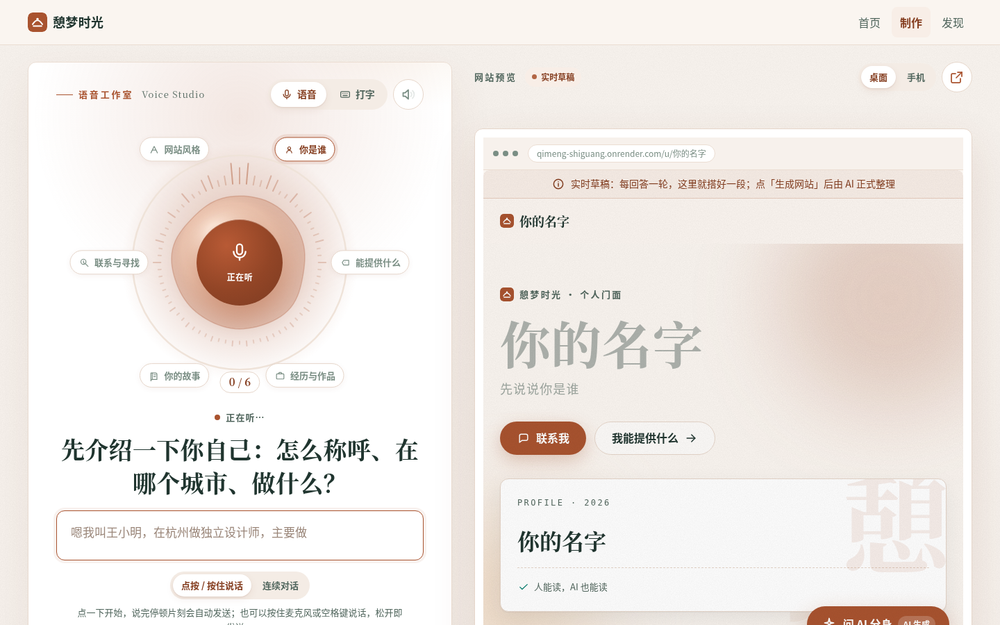
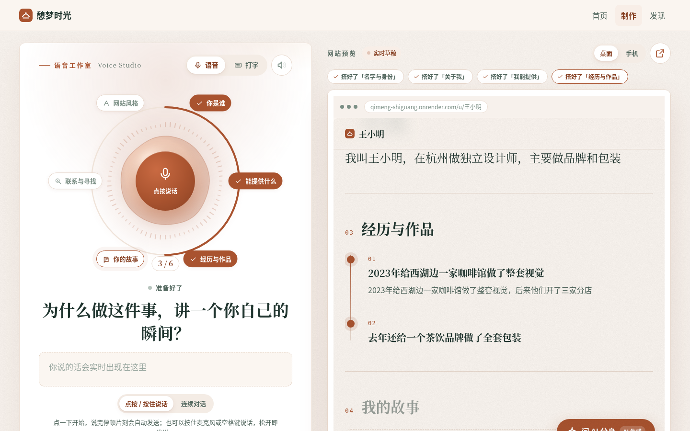
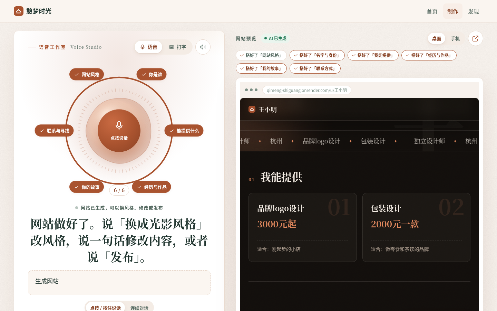
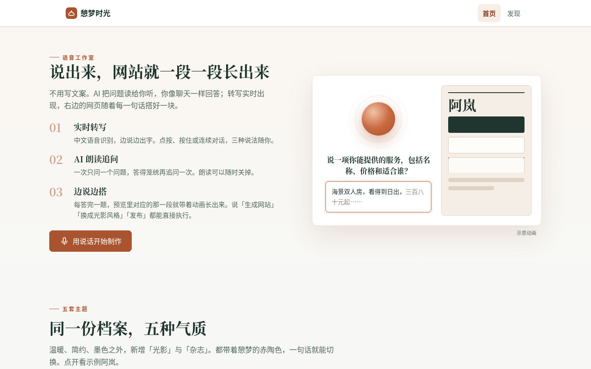
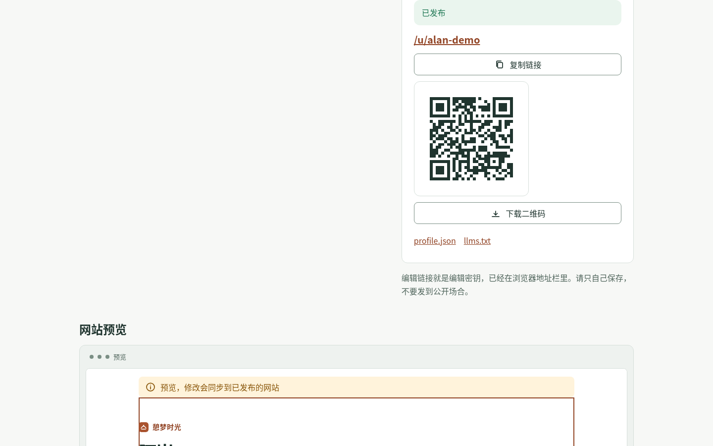
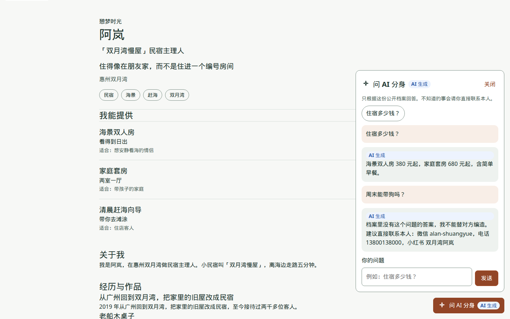
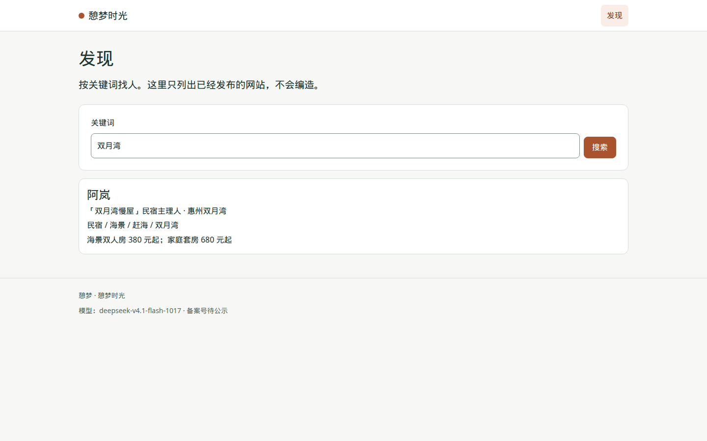

# 憩梦时光

对着麦克风聊 10 分钟，AI 边听边搭，生成一个「既能被人找到、也能被 AI 找到」的个人网站。

项目负责人：杜明航（产品经理 + 全栈开发）

在线体验：<https://qimeng-shiguang.onrender.com>

Render 免费实例闲置后会休眠，首次打开可能需要等待约 1 分钟；免费版没有持久磁盘，重启后 data/ 里的网站会清空（正式版换 PostgreSQL 或挂载磁盘）。如果示例网站「阿岚」不在，启动时会自动放回，即使已经有其他已发布的网站。中文地址是 `/u/阿岚`，英文别名是 `/u/alan`（若有人发布了名为 alan 的网站，英文地址会优先显示那一份）。页面上标着「示例」。

把一个人讲清楚：采访或导入其他 AI 里的记忆，整理成人生档案，渲染成个人网站，并带上 AI 分身和机器可读文件。网站给人看，也给 AI 看。界面按憩梦拾光品牌规范（设计系统 v3）：陶土色主行动、暖纸底色、宋体展示标题、手绘下划线、统一的线性图标，不用渐变光晕。首页首屏是「聊十分钟，长出一个你的网站」和三张迷你网页拼贴（都链接到示例网站的真实页面），往下是三步、同一份档案的五种样子、读取示例网站真实 profile.json / llms.txt 的演示，以及语音球五种状态。工作台左边是语音对话（语音球外圈就是话题进度），右边是实时预览；发现页可以用一句话找人，并说明每位结果为什么匹配。所有页面禁止内联脚本；系统开启「减少动态效果」时不播放动画，脚本没加载时内容照常显示。界面截图在阶段 6 统一更新。


## 语音工作室

工作台现在是一个「语音工作室」：中间是一颗跟着你声音起伏的光球，外圈是六个话题，右边的网页随着每一句回答一段一段长出来。

| 正在听（实时字幕 + 声纹光球） | 边说边搭（逐段生长的草稿） | 生成后（光影主题） |
| --- | --- | --- |
|  |  |  |

- **说话就行**：浏览器原生语音识别（`zh-CN`），边说边出实时字幕；停顿多久算说完会自适应（话停在「然后」「还有」这类地方会多等一会儿）。
- **一句一句地回**：采访官先用一句话复述你说的要点，再问下一个问题；回复走流式接口，说一句、读一句。每个话题的要点会留在问题下方。
- **随时打断**：采访官说话时开口、点麦克风、按空格或 Esc，它就停下来听你说。
- **口令**：「跳过」「返回」「我说错了」「再说一遍」「等一下」，说出来、打字或点按钮都可以；长句里出现这些词不会被误当成口令。
- **点一块，改一块**：生成网站后点预览里的任意版块，说一句话只改这一块，其他版块由服务端强制保持不变。
- **两种说法**：「点按 / 按住说话」（点一下开始，再点一下发送；按住超过半秒是对讲机模式，桌面端也可以按住空格键）和「连续对话」（采访官读完问题自动开麦，你说完它再问下一个）。
- **光球**：麦克风接入 Web Audio `AnalyserNode`，光球的起伏、外圈刻度和光晕都跟着真实音量走；没授权麦克风时用合成律动。
- **采访官会开口**：问题用语音合成（中文声音）读出来，右上角喇叭可以关掉；问题以打字机的方式逐字出现。
- **语音指令**：说「生成网站」「换成光影风格」「发布」就能直接操作；生成之后随口说的话会当作一句话修改（例如「把价格写清楚」）。
- **边说边搭**：每答一轮，服务端用规则（不调用模型）拼一份草稿，预览双缓冲刷新，新长出来的版块会高亮并自动滚过去，上方的搭建日志写着「搭好了「我能提供」」。还没说到的版块显示「待补充」，不编造。
- **降级**：浏览器识别不可用时，若服务端配置了语音识别就自动换过去，否则切到打字，已聊内容都保留；流式中断时不会重复提交。麦克风闲置 45 秒、切到打字或离开页面时会释放。
- **公开网站上的分身**也能按麦克风提问、勾选「朗读回答」。

支持情况：Chrome / Edge（桌面和安卓）与 Safari（macOS / iOS 14.5+）可以语音识别；Firefox 只能打字。Chrome 的识别走 Google 的在线服务，在中国大陆可能连不上，这时会提示改用 Edge、Safari 或打字。

## 个人网站风格

三种职业风格，加两种通用样子。主行动、链接和焦点始终是品牌陶土；各风格自己的块面色（暮蓝、薰衣草、黄）只作背景和插画。

| 风格 | 适合 | 版式 |
| --- | --- | --- |
| **慢屋** | 民宿、手作、咖啡、慢生活 | 暮色首屏（左侧标题、右侧首图）+ 撕边纸张叙事带：三张拍立得配服务名和价格、手写诗句 |
| **纸山** | 品牌、平面、插画、摄影等作品集 | 固定侧栏（头像、名字、导航）+ 薰衣草标题带 + 剪纸山 + 代表作三联展墙 |
| **贴纸** | 产品、交互、独立开发、创业 | 大黄块 + 粗黑大标题 + 满幅首图 + 手绘涂鸦与贴纸；项目卡片 |
| 简约 / 墨色 | 想要留白多 / 沉稳有故事感 | 保留原版式 |

- **按职业推荐**：没说想要什么风格时，按身份、标签和服务推荐（民宿→慢屋，设计→纸山，产品开发→贴纸）。随时可以说「换成纸山风格」，或在工作台点缩略图。
- **旧主题名继续可用**：温暖、光影 → 慢屋；杂志 → 纸山。老档案和 `?theme=warm` 这类旧链接照常打开。任何公开页加 `?theme=slowhouse|papermountain|sticker|simple|ink` 只预览，不改档案。
- **图片（可选）**：工作台「图片」里填首图和最多 6 张图集。只接受 `https://` 开头的地址或本站 `/img/` 图片，有一张不合格就整体拒绝并说明原因；暂不支持直接上传。没有图片时每种风格都有自己的插画兜底。
- **手绘装饰**：手绘线、撕边纸张、剪纸山在服务端按名字生成（`src/ornaments.js`），同一个人每次形状相同，关掉脚本也看得到。
- **规范**：第二屏都是服务清单；每个版块都能在工作台里点选、一句话只改这一块；只动 `transform` / `opacity`，「减少动态效果」时全部关闭；Lighthouse（本机）三种风格无障碍 100，手机 LCP 2.2–2.4 秒。

## 借鉴说明

视觉和动效的思路参考了 [Personal Homepage Skill](https://github.com/shengjidaguai-china/personal-homepage-skill)（作者 powerycy），致谢。借鉴的是设计思路：先定参考风格再生成、Hero / About / Highlights / Projects / Contact 的版块公式、缺资料时写「待补充」而不是编数字、Cinematic Scroll 与 Magazine 风格预设、以及「只动 transform/opacity、倾斜小于 10°、磁吸小于 8px、尊重减少动态效果、不劫持滚动」这组动效规范。**没有复制它的任何代码、模板、提示词或素材**，所有实现都是本仓库重新写的。该项目使用「Personal Homepage Skill Non-Commercial License」，仅限非商业用途；若憩梦时光转为商业使用并需要直接使用其任何内容，需要先取得作者书面许可。

## 演示

阿岚是惠州双月湾的民宿主理人，是启动时自动放回的示例网站（`/u/阿岚`、`/u/alan`，默认杂志主题）。上面的截图是用语音模式走的一遍：杭州的独立设计师王小明说了六段话 → 「生成网站」→ 「换成杂志风格」→ 「换成光影风格」→ 「发布」。分身能按档案回答价格，档案里没有的问题会诚实地说不知道。

| 首页 | 发布 | AI 分身 |
| --- | --- | --- |
|  |  |  |



更多步骤（导入、生成、一句话修改、发布，以及手机宽度）在[项目介绍书](docs/项目介绍书.md)。

## 这个 MVP 做什么

- 语音工作室：说话回答、实时字幕、声纹光球、语音读题、语音指令；不支持时自动改为打字
- AI 采访：6 个话题，一次一个问题（服务端强制），笼统回答最多追问两轮，第二轮会给一个可以照着说的例子
- 边说边搭：每答一轮，预览里长出对应版块（`GET /api/sessions/:id/draft`，`/preview/:id?draft=1`）
- 导入其他 AI 的记忆：复制提问词，再把总结贴回来；原文不公开
- 档案抽取，并用慢屋 / 纸山 / 贴纸三种职业风格（另有简约、墨色）渲染；按职业推荐风格，可选首图与图集
- 一句话修改，只改被要求的部分
- 发布到 `/u/名字`，之后的修改自动同步
- JSON-LD、`profile.json`、`llms.txt`、`sitemap.xml`
- 网站上的 AI 分身，标明「AI 生成」，不能被要求换身份
- 发现页按关键词找人；没有密钥或模型出错时自动用离线规则
- 每个网站页脚都有「我也要一个 →」

## 快速开始

需要 Node.js 18.17 或更高，不需要 `npm install`。

```bash
cp .env.example .env
npm start
```

在 `.env` 里填写 `LLM_API_KEY`。地址和模型名的示例是：

```bash
LLM_BASE_URL=https://token.iflink.tech/v1
LLM_MODEL=deepseek-v4.1-flash-1017
```

不要把填好的 `.env` 提交到仓库。

没有密钥时：

```bash
npm run demo
```

测试：

```bash
npm test
```

当前 44 项测试全部通过（原有 16 项 + 语音工作室 5 项 + 语音对话 11 项 + 安全加固 8 项 + 页面、发现与图片 4 项）。部署方式（Docker 与 Render）写在[项目介绍书](docs/项目介绍书.md)。

## 接口与安全

| 接口 | 说明 |
| --- | --- |
| `POST /api/sessions/:id/turns` | 一轮对话（Server-Sent Events）：依次推送 `intent`、`meta`、`sentence`（一句一条）、`action`、`done` |
| `POST /api/sessions/:id/commands` | 口令按钮：`skip` / `back` / `redo` / `repeat` |
| `POST /api/sessions/:id/edits` | 一句话修改；带 `section` 时只允许改这个版块 |
| `GET /api/voice/config` | 服务端语音识别 / 朗读是否可用 |
| `POST /api/asr`、`POST /api/tts` | 服务端语音识别 / 朗读；未配置时返回 501，前端自动退回浏览器能力 |

原有接口（`/messages`、`/imports`、`/profile`、`/publish`、`/api/sites/:slug/ask` 等）全部保留。

- **安全响应头**：所有响应带 CSP（不允许内联脚本）、`X-Frame-Options`、`Referrer-Policy`、`Permissions-Policy`（只允许本站使用麦克风）；部署在 HTTPS 代理后时加 HSTS。个人网站的启动数据放在不执行的 JSON 数据块里。
- **限流**：按访客 IP 分类计数——新建会话、调用大模型的操作、访客问 AI 分身、语音接口、埋点各有额度，超出返回 429 和 `Retry-After`。计数在内存里，单实例部署够用。部署在代理后需要 `TRUST_PROXY=1`（Render 自动识别）。
- **输入**：修改指令 600 字、回答 4000 字、AI 分身提问 300 字、录音 3 MB 为上限；版块名和主题名只接受白名单内的值。

## 文档

- [产品需求文档（Markdown）](docs/PRD/憩梦时光_PRD_完整版.md)
- [产品需求文档（Word）](docs/PRD/憩梦时光_PRD_完整版.docx)
- [项目介绍书](docs/项目介绍书.md)
