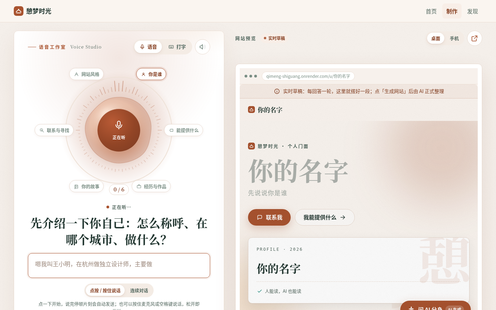
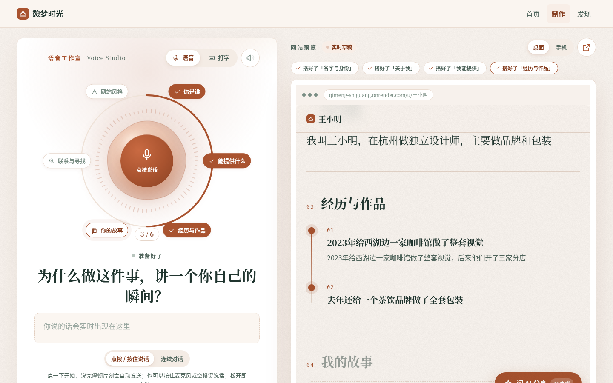
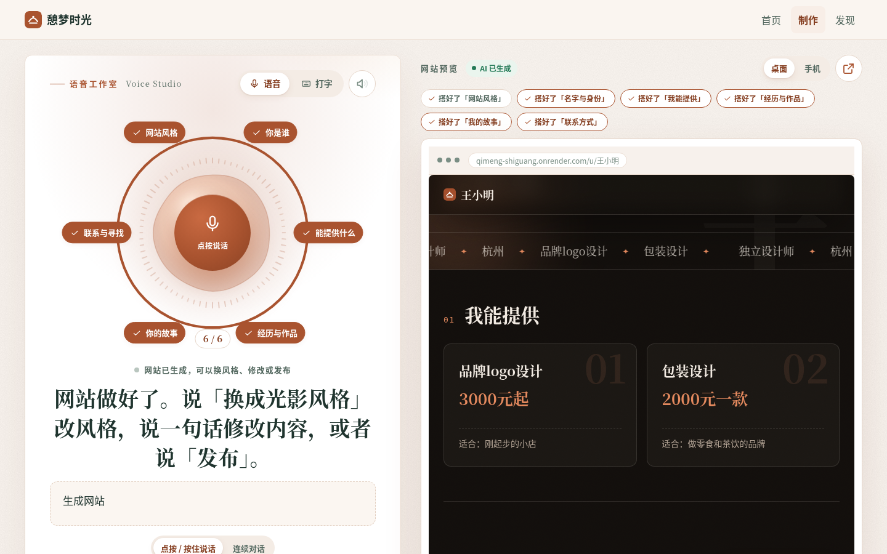
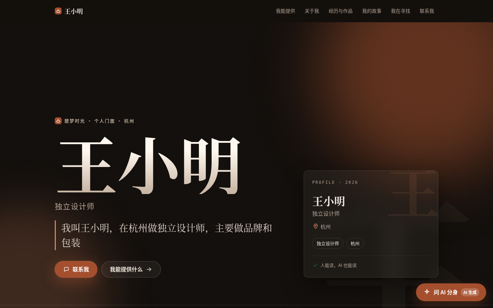
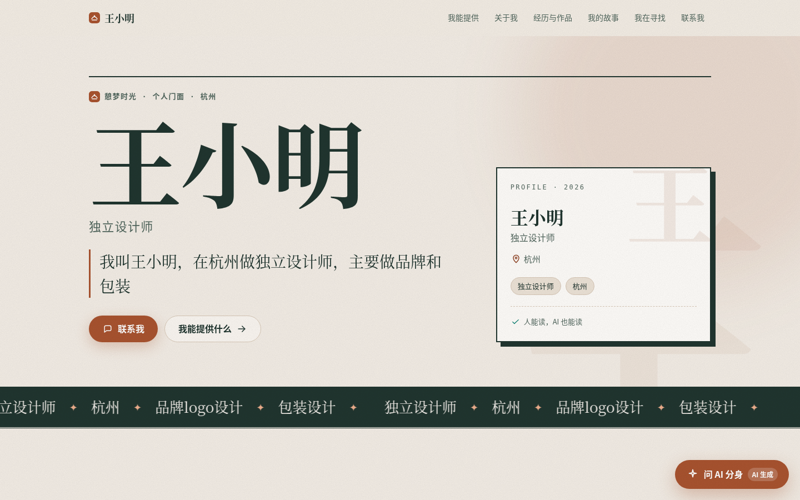
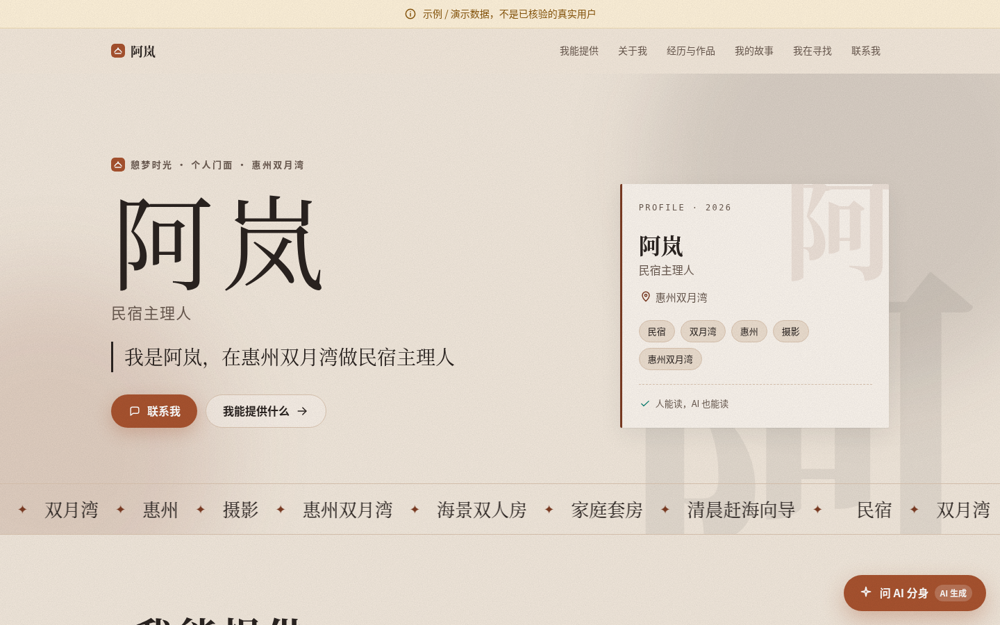
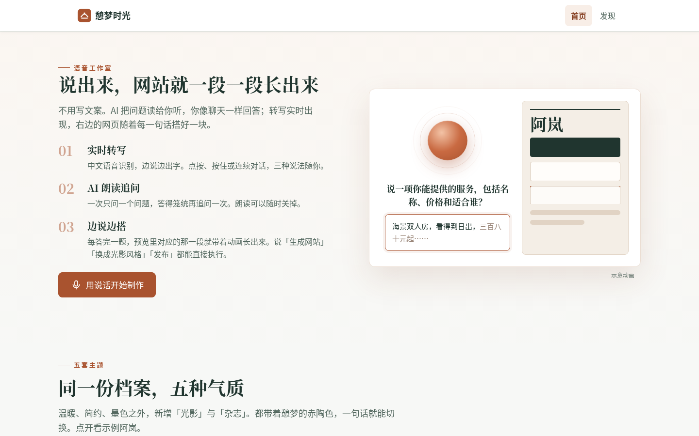
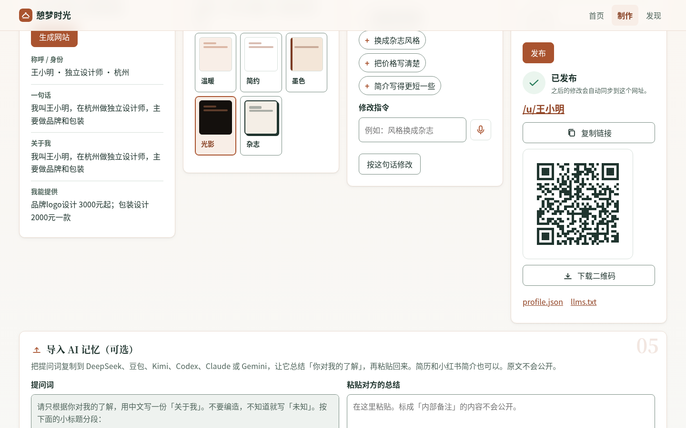
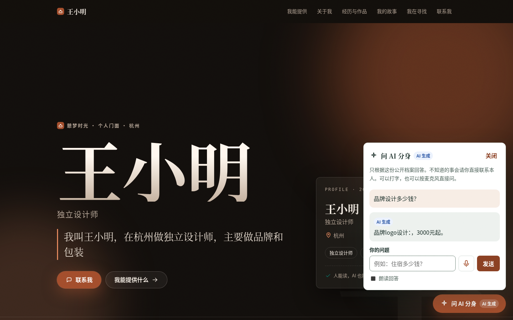
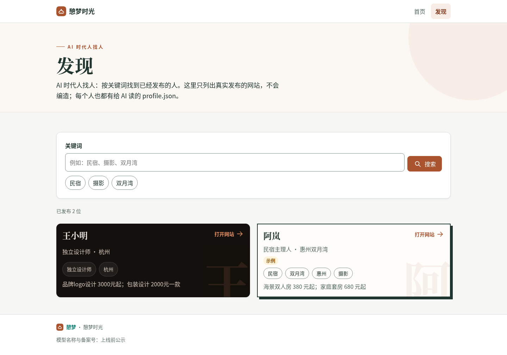

# 憩梦时光

对着麦克风聊 10 分钟，AI 边听边搭，生成一个「既能被人找到、也能被 AI 找到」的个人网站。

项目负责人：杜明航（产品经理 + 全栈开发）

在线体验：<https://qimeng-shiguang.onrender.com>

Render 免费实例闲置后会休眠，首次打开可能需要等待约 1 分钟；免费版没有持久磁盘，重启后 data/ 里的网站会清空（正式版换 PostgreSQL 或挂载磁盘）。如果示例网站「阿岚」不在，启动时会自动放回，即使已经有其他已发布的网站。中文地址是 `/u/阿岚`，英文别名是 `/u/alan`（若有人发布了名为 alan 的网站，英文地址会优先显示那一份）。页面上标着「示例」。

把一个人讲清楚：采访或导入其他 AI 里的记忆，整理成人生档案，渲染成个人网站，并带上 AI 分身和机器可读文件。网站给人看，也给 AI 看。界面按憩梦拾光品牌规范：陶土色主行动、文字标志、统一的线性图标。首页是海边露台的全屏首图，中文标题用系统宋体，正文用系统黑体；滚动时内容依次淡入，「AI 时代人找人」一节会逐行打出 profile.json 和 llms.txt 的片段。系统开启「减少动态效果」时不播放动画，脚本没加载时内容照常显示。工作台带六个话题的进度条、主题缩略图、修改建议、生成时的骨架屏，桌面端预览固定在右侧。


## 语音工作室

工作台现在是一个「语音工作室」：中间是一颗跟着你声音起伏的光球，外圈是六个话题，右边的网页随着每一句回答一段一段长出来。

| 正在听（实时字幕 + 声纹光球） | 边说边搭（逐段生长的草稿） | 生成后（光影主题） |
| --- | --- | --- |
|  |  |  |

- **说话就行**：浏览器原生语音识别（`zh-CN`），边说边出实时字幕；停顿约 1.5 秒自动发送。
- **两种说法**：「点按 / 按住说话」（点一下开始，再点一下发送；按住超过半秒是对讲机模式，桌面端也可以按住空格键）和「连续对话」（采访官读完问题自动开麦，你说完它再问下一个）。
- **光球**：麦克风接入 Web Audio `AnalyserNode`，光球的起伏、外圈刻度和光晕都跟着真实音量走；没授权麦克风时用合成律动。
- **采访官会开口**：问题用语音合成（中文声音）读出来，右上角喇叭可以关掉；问题以打字机的方式逐字出现。
- **语音指令**：说「生成网站」「换成光影风格」「发布」就能直接操作；生成之后随口说的话会当作一句话修改（例如「把价格写清楚」）。
- **边说边搭**：每答一轮，服务端用规则（不调用模型）拼一份草稿，预览双缓冲刷新，新长出来的版块会高亮并自动滚过去，上方的搭建日志写着「搭好了「我能提供」」。还没说到的版块显示「待补充」，不编造。
- **降级**：Firefox 等不支持语音识别的浏览器会显示提示并切到打字模式，流程完全一样；麦克风被拒绝、网络不可用时给出中文原因，可以随时改用打字。
- **公开网站上的分身**也能按麦克风提问、勾选「朗读回答」。

支持情况：Chrome / Edge（桌面和安卓）与 Safari（macOS / iOS 14.5+）可以语音识别；Firefox 只能打字。Chrome 的识别走 Google 的在线服务，在中国大陆可能连不上，这时会提示改用 Edge、Safari 或打字。

## 五套主题与特效

在保留憩梦主视觉（陶土色主行动、宋体中文标题、4px 栅格、线性图标、页脚克制的青玉绿母品牌署名）的前提下，个人网站新增两套主题，并加了一层动效：

| 光影（深色电影感） | 杂志 | 墨色 |
| --- | --- | --- |
|  |  |  |

- 主题：温暖、简约、墨色、**光影**（深色、大字、留白、电影感滚动）、**杂志**（粗线分栏、编号、滚动字带）。任何公开页都可以加 `?theme=cinema|editorial|warm|simple|ink` 只看效果，不改档案。
- 特效：跟随鼠标的柔光、首屏大字乱码解码、按钮磁吸（≤6px）、卡片 3D 倾斜（≤5°）与跟随光斑、首屏巨字视差、「关于我」随滚动逐字点亮、经历时间线随滚动生长、玻璃导航与滚动定位、细颗粒噪点、技能字带跑马灯。
- 克制：只动 `transform` / `opacity`，不劫持滚动；系统开启「减少动态效果」时全部关闭；脚本没加载时所有内容照常可见。

## 借鉴说明

视觉和动效的思路参考了 [Personal Homepage Skill](https://github.com/shengjidaguai-china/personal-homepage-skill)（作者 powerycy），致谢。借鉴的是设计思路：先定参考风格再生成、Hero / About / Highlights / Projects / Contact 的版块公式、缺资料时写「待补充」而不是编数字、Cinematic Scroll 与 Magazine 风格预设、以及「只动 transform/opacity、倾斜小于 10°、磁吸小于 8px、尊重减少动态效果、不劫持滚动」这组动效规范。**没有复制它的任何代码、模板、提示词或素材**，所有实现都是本仓库重新写的。该项目使用「Personal Homepage Skill Non-Commercial License」，仅限非商业用途；若憩梦时光转为商业使用并需要直接使用其任何内容，需要先取得作者书面许可。

## 演示

阿岚是惠州双月湾的民宿主理人，是启动时自动放回的示例网站（`/u/阿岚`、`/u/alan`，默认杂志主题）。上面的截图是用语音模式走的一遍：杭州的独立设计师王小明说了六段话 → 「生成网站」→ 「换成杂志风格」→ 「换成光影风格」→ 「发布」。分身能按档案回答价格，档案里没有的问题会诚实地说不知道。

| 首页 | 发布 | AI 分身 |
| --- | --- | --- |
|  |  |  |



更多步骤（导入、生成、一句话修改、发布，以及手机宽度）在[项目介绍书](docs/项目介绍书.md)。

## 这个 MVP 做什么

- 语音工作室：说话回答、实时字幕、声纹光球、语音读题、语音指令；不支持时自动改为打字
- AI 采访：6 个话题，一次一个问题，笼统回答最多追问一次
- 边说边搭：每答一轮，预览里长出对应版块（`GET /api/sessions/:id/draft`，`/preview/:id?draft=1`）
- 导入其他 AI 的记忆：复制提问词，再把总结贴回来；原文不公开
- 档案抽取，并用温暖 / 简约 / 墨色 / 光影 / 杂志五套主题渲染，带滚动与指针特效
- 一句话修改，只改被要求的部分
- 发布到 `/u/名字`，之后的修改自动同步
- JSON-LD、`profile.json`、`llms.txt`、`sitemap.xml`
- 网站上的 AI 分身，标明「AI 生成」，不能被要求换身份
- 发现页按关键词找人；没有密钥或模型出错时自动用离线规则
- 每个网站页脚都有「我也要一个 →」

## 快速开始

需要 Node.js 18.17 或更高，不需要 `npm install`。

```bash
cp .env.example .env
npm start
```

在 `.env` 里填写 `LLM_API_KEY`。地址和模型名的示例是：

```bash
LLM_BASE_URL=https://token.iflink.tech/v1
LLM_MODEL=deepseek-v4.1-flash-1017
```

不要把填好的 `.env` 提交到仓库。

没有密钥时：

```bash
npm run demo
```

测试：

```bash
npm test
```

当前 21 项测试全部通过（原有 16 项 + 语音工作室 5 项）。部署方式（Docker 与 Render）写在[项目介绍书](docs/项目介绍书.md)。

## 文档

- [产品需求文档（Markdown）](docs/PRD/憩梦时光_PRD_完整版.md)
- [产品需求文档（Word）](docs/PRD/憩梦时光_PRD_完整版.docx)
- [项目介绍书](docs/项目介绍书.md)
