# 憩梦时光 · 产品需求文档（PRD）完整版

> 兼作商业计划书 · 基于《憩梦时光 · 项目梳理与 MVP 架构方案》（Nov 7, 2026 · @David）扩写
> 一句话定位：**聊 10 分钟，AI 帮你生成一个「既能被人找到、也能被 AI 找到」的个人网站。**

## 0. 文档信息

### 0.1 基本信息

| 项目 | 内容 |
| --- | --- |
| 文档名称 | 憩梦时光 · 产品需求文档（PRD）完整版（兼商业计划书） |
| 产品名称 | 憩梦时光（品牌视觉规范 V2.0 中对应产品为「憩梦拾光 · 个人数字人生操作系统」，命名差异见第 18 章「需要团队拍板的问题」） |
| 所属品牌 | 憩梦（母品牌，生态共 7 个产品；已知：时光、美宿、云宿、智荐、臻选、纵横，以及视觉规范中的星光、智鉴等，完整矩阵名单待补充） |
| 原方案作者 | @David |
| 原方案日期 | 2026-11-07 |
| 当前版本 | V1.0（完整版） |
| 文档状态 | 评审稿 |
| 代码仓库 | GitHub：<https://github.com/123Daved>（杜明航的 GitHub；具体仓库名待补充） |
| 适用阶段 | MVP（惠州 AI 比赛，11 月 14 日）→ 种子用户 → 正式版 |
| 关联文档 | 《憩梦品牌视觉规范 V2.0》（2026-10-21 生效，版本 2.0.0）；MVP 代码包 `qimeng-shiguang-mvp.zip` |

### 0.2 版本记录

| 版本 | 日期 | 修订人 | 修订内容 |
| --- | --- | --- | --- |
| V0.1 | 2026-11-07 | @David | 《项目梳理与 MVP 架构方案》初稿：结论、项目逻辑、目标用户、产品架构、MVP 范围、技术架构、商业模式、合规风险、7 天冲刺、路线图、拍板问题 |
| V1.0 | 2026-11-12 | 项目组（杜明航牵头） | 扩写为完整 PRD：新增项目成员、名词解释、产品概述与目标、用户画像与用户故事、核心 Demo 理念、功能需求详述、非功能需求、技术架构明细（MVP 现状 / 正式版规划）、前端界面与视觉规范、数据埋点与指标、里程碑、代码仓库规范；原文占位图以 mermaid 图/表格补齐。原文主题内容、结论、数据与链接全部保留 |

### 0.3 阅读指引

| 读者 | 建议重点阅读 |
| --- | --- |
| 评委 / 投资人 / 合作机构 | 第 2 章结论先行、第 3 章项目逻辑、第 7 章核心 Demo 理念、第 13 章商业模式与增长、第 15 章合规与风险 |
| 产品 / 设计 | 第 5–10 章、第 12 章前端界面与视觉规范 |
| 研发 | 第 9–11 章、附录 A 代码仓库 |
| 运营 / BD | 第 6 章目标用户、第 13 章商业模式与增长、第 16 章冲刺计划 |

---

## 1. 项目成员

| 序号 | 姓名 | 角色 | 主要职责 |
| --- | --- | --- | --- |
| 1 | **杜明航** | **产品经理 + 全栈开发** | **产品规划：** 产品定位、愿景台阶与迭代路线、MVP 范围与取舍；**需求与原型：** PRD 撰写、用户故事、页面原型与交互流程、验收标准；**前后端开发：** Node.js 服务端、前端工作台与个人网站模板、档案数据层；**AI 智能体与提示词：** 采访官 / 整理师 / 编辑 / AI 分身四个智能体与 `src/agent/prompts.js` 调优、模型接入与降级；**部署运维：** 云服务器部署、`.env` 配置、域名与备案协同、监控与故障处理；**项目管理：** 7 天冲刺推进、演示彩排、对接种子用户与合作方。GitHub：<https://github.com/123Daved> |
| 2 | 铭心追梦 | 团队成员（角色待定） | 原方案中被邀请加入 GitHub 私有仓库的协作者；具体分工待补充 |
| 3 | 待补充 | 待补充（如：种子用户与 BD、设计、运营） | 待补充 |
| 4 | 待补充 | 待补充 | 待补充 |

> 说明：除杜明航外，其他成员的真实姓名、履历、分工均**待补充**，本文不作推定。原方案作者署名为 @David。原方案「需要团队拍板的问题」中「谁负责去约这 3 位试用者」也需在成员分工中落实。

---

## 2. 结论先行

憩梦时光的 MVP 收敛成一句话：**聊 10 分钟，AI 帮你生成一个「既能被人找到、也能被 AI 找到」的个人网站。**

数字人生档案、数字分身是长期愿景；比赛和首批用户只需要看到这一个闭环跑通。

五个核心判断：

1. **切入点：** 2026 年 OPC（一人公司）已从创业圈的自发形态进入政策扶持体系，广东省 3 月出台了专门的人工智能 OPC 行动方案。个体最缺的是一个可信、结构化、能成交的「个人门面」。
2. **真正的资产是档案，不是网站。** 网站、名片、简历、AI 分身都只是同一份结构化「人生档案」的不同表达。架构上把档案做成**核心数据层**，网站只是第一个输出。
3. **「人找人」在 AI 时代 = 智能体替人找人。** 要让 AI 找得到你，个人信息必须**机器可读**。每个网站同时输出 JSON-LD、profile.json、llms.txt，这正好把**憩梦时光**和**憩梦智荐（GEO）**接上。
4. **差异化不在「AI 能建站」。** Gamma、B12、Manus 都能把简历变成网站。我们的三个差异点：采访式收集（不会写也能做）、导入其他 AI 里的记忆（打破 AI 信息孤岛，**导入 Codex、Claude、豆包、Gemini 记忆**）、网站自带会说话的 AI 分身。
5. **流量平台不要一开始就做「广场」。** 冷启动靠两条：每个网站页脚的「我也要做一个」传播环，以及憩梦美宿 / 云宿的民宿主理人作为首批种子用户。

---

## 3. 项目逻辑梳理：从愿景到切入点

憩梦时光是一个**「以人为中心」**的平台：平台里最小的单位是**一个人**，不是一条内容。所有功能都围绕一个问题：**这个人是谁、能提供什么、怎么找到他。**

### 3.1 三个时代的「找」

| 时代 | 谁找谁 | 入口 | 个体要做的事 |
| --- | --- | --- | --- |
| PC 互联网 | 人找信息、人找货 | 搜索引擎、门户 | 做网站、做 SEO |
| 移动互联网 | 货与内容找人 | 推荐算法、超级 App | 做账号、追流量、守平台规则 |
| AI 时代 | 人（和替人办事的智能体）找人 | 对话框、智能体 | 拥有一份 AI 读得懂、信得过的个人档案 |

AI 时代的关键是「人找人」。

举个例子：游客问豆包「惠州双月湾有没有靠谱的民宿主理人」。AI 会去找可信、结构化的信息。抖音小红书里的内容属于平台，AI 很难读到也带不走；一个属于自己、机器可读的个人网站，才是被 AI 找到的入口。

### 3.2 以人为中心 vs 以内容为中心

- **以内容为中心（抖音、小红书）：** 内容是单位，人追着算法跑，粉丝和流量归平台。
- **以人为中心（憩梦时光）：** 人是单位，内容挂在人下面；网站先回答「我是谁、我能为你做什么」，再展示内容。
- 对 OPC 来说，客户最终买的是**「这个人」**，所以个人网站就是店面，「服务清单」必须是网站的第二屏。

### 3.3 愿景拆成可交付的台阶

「生命操作系统」是对的方向，但一次讲完会让评委和用户都抓不住重点。建议按下面的台阶讲，每一级都在丰富同一份档案：

1. **个人网站（现在）：** 把一个人讲清楚，能被人和 AI 找到。
2. **AI 分身（MVP 已有雏形）：** 网站上的 AI 替你 24 小时回答访客。
3. **连接与交易：** 人找人、预约、买卖，接入憩梦智荐和憩梦臻选。
4. **内容外发：** 档案里的故事交给憩梦纵横，分发到抖音、小红书，再把流量引回个人网站。
5. **生命档案（长期）：** 影像、手记、时间线，一生的故事。

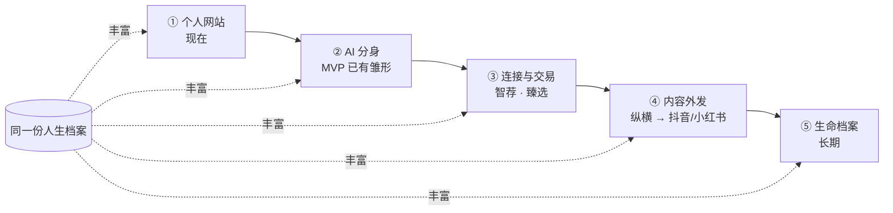

---

## 4. 名词解释

| 名词 | 解释 |
| --- | --- |
| 憩梦 | 母品牌。生态内多个产品共用同一份档案与同一个 AI 底座 |
| 憩梦时光 | 本产品：以人为中心的个人数字门面与人生档案平台（视觉规范中对应「憩梦拾光」） |
| 憩梦美宿 / 憩梦云宿 | 生态内民宿相关产品，其民宿主理人 / 民宿联盟是首批种子用户来源 |
| 憩梦智荐（GEO） | 生态内负责「人找人」与 GEO 的产品，与时光的机器可读输出衔接 |
| 憩梦臻选 | 生态内负责交易的产品 |
| 憩梦纵横 | 生态内负责内容外发（抖音、小红书等）的产品 |
| OPC | One Person Company，一人公司 |
| GEO | Generative Engine Optimization，生成式引擎优化，让内容被 AI 读懂、引用与推荐 |
| 人生档案 / 档案 | 一个人的结构化数据（v0.1 字段见 11.4），是平台唯一需要长期积累的资产 |
| 采访 | 由「采访官」智能体一次一问、覆盖 6 个话题的信息收集方式 |
| 导入 AI 记忆 | 用户把提问词复制到其他 AI，让它总结「你对我的了解」，再粘贴回憩梦时光 |
| AI 分身 | 个人网站上依据档案回答访客的 AI，显著标注「AI 生成」 |
| 一句话修改 | 用自然语言修改档案（如「风格换成简约」），由「编辑」智能体执行 |
| JSON-LD | 嵌入网页的结构化数据（schema.org 词汇），供搜索引擎与 AI 读取 |
| profile.json | 每个个人网站输出的机器可读档案文件 |
| llms.txt | 面向大模型的站点说明文本文件 |
| sitemap.xml | 站点级地图文件 |
| DEMO_MODE | 演示模式开关（`DEMO_MODE=1`），不配 API Key 也能完整跑通 |
| 自动降级 | 大模型接口出错时自动切换到离线规则版智能体 |
| 会话链接即编辑密钥 | MVP 不做登录，持有会话链接即可编辑对应网站 |
| MODEL_NOTICE | 代码中预留的模型名称与备案号公示位 |
| 关口 | 路线图中进入下一阶段前必须满足的条件 |

---

## 5. 产品概述与目标

### 5.1 产品定义

憩梦时光是一个**以人为中心**的 AI 个人门面平台：用户通过 **AI 采访**或**导入其他 AI 的记忆**，生成一份结构化**人生档案**，系统用模板把档案渲染为个人网站，并同时输出机器可读文件，让这个人**既能被人找到，也能被 AI 找到**；网站上的 **AI 分身**依据档案 24 小时回答访客。

### 5.2 要解决的问题

1. 个体（尤其 OPC、民宿主理人）缺少可信、结构化、能成交的「个人门面」，依赖平台、流量归平台。
2. 一个人在五个 AI、三个平台里都有自己的碎片，信息孤岛无法汇总。
3. 平台内容 AI 很难读到也带不走，个体在 AI 时代「找不到 / 不被找到」。
4. 不会写文案、不会建站的人也需要专业门面。

### 5.3 产品目标

| 阶段 | 目标 | 衡量方式 |
| --- | --- | --- |
| MVP / 比赛 | 核心闭环稳定跑通、演示不出错；拿到 3 位真实用户的网站 | 现场演示成功；3 个真实网站已发布并出现在发现页 |
| 种子用户期 | 验证「用户愿意分享自己的网站」 | 第 14 章五个数：采访完成率、发布率、访客数、AI 分身提问数、页脚新用户数（目标值待补充） |
| 正式版 / V1 | 完成合规三道硬门槛，上线账号体系与专业版 | ICP 备案、生成式 AI 应用登记、个人信息保护措施完成；专业版付费转化（目标值待补充） |
| 长期 | 从「工具」走向「平台」：人找人、交易、内容外发、生命档案 | 网站数量足以支撑发现页与匹配（阈值待补充） |

### 5.4 非目标（MVP 暂不做）

手机号登录与账号体系、独立域名绑定与支付、语音输入、图片与视频上传、微信小程序、内容发布流与关注关系；不做「广场」型流量平台。MVP 用「会话链接即编辑密钥」代替登录，正式对外前必须补上账号。

### 5.5 差异化与竞品

| 维度 | Gamma / B12 / Manus 等 | 憩梦时光 |
| --- | --- | --- |
| 生成起点 | 从「文档」（简历等）生成网页 | 从「人」生成档案，网页只是输出之一 |
| 信息收集 | 需用户提供成稿资料 | 采访式收集（不会写也能做）+ 导入其他 AI 的记忆 |
| 访客互动 | 静态页面 | 网站自带会说话的 AI 分身 |
| 被 AI 找到 | 非核心 | 每站输出 JSON-LD、profile.json、llms.txt，衔接憩梦智荐（GEO） |
| 网络效应 | 单站工具 | services × seeking 的人找人网络 + 本地生态（民宿联盟、惠州 OPC） |

---

## 6. 目标用户与核心场景

首批用户建议聚焦**民宿主理人**和**在地服务型 OPC**：生态里已有触达渠道，他们有「被找到 → 成交」的真实需求，付费意愿也最强。毕业生量大但付费弱，适合作为第二批和传播源。

| 用户 | 痛点 | 网站上最重要的内容 | 首批获取渠道 | 优先级 |
| :-- | --- | --- | --- | --- |
| 民宿主理人 / 在地向导 | 依赖 OTA 平台，没有属于自己的门面和回头客 | 主理人故事、房型与服务、预订联系方式 | 憩梦美宿、憩梦云宿的民宿联盟 | 首选 |
| OPC / 自由职业者（摄影、设计、咨询、培训） | 作品散落各平台，客户不知道怎么找、怎么下单 | 服务清单、案例、合作方式 | 惠州 OPC 社区、创业园区 | 首选 |
| 应届毕业生 | 简历是静态的，展示不了作品和个性 | 经历、技能、作品、求职意向 | 高校、实验室、就业中心 | 第二批 |
| 个体户 / 小店主 | 只有朋友圈，不会做小程序 | 店铺介绍、产品、地址 | 线下地推 | 第二批 |

**惠州本地的切口：** 惠州 2026 年 5 月发布了首批 38 个 AI 应用场景需求清单（含「AI+服务业」）；惠阳区也已揭牌首个 OPC 社区。比赛叙事可以落在「用 AI 帮惠州的文旅主理人和 OPC 拥有自己的数字门面」，比泛泛地讲「全国个人网站」更有说服力。

**一个完整场景（也是演示脚本的原型）：** 双月湾的民宿主理人阿岚打开憩梦时光 → 把她在 DeepSeek 里得到的「关于我」总结粘贴进来 → AI 又追问了 4 个问题 → 一键生成网站 → 说一句「风格温暖一点」改版 → 发布链接发朋友圈 → 访客问网站上的 AI 分身「周末能带狗吗」。

### 6.1 用户画像

> 以下画像依据上表的用户分层与原文场景整理，为典型化描述，不代表已调研的真实个人；年龄、收入等量化特征待用户访谈后补充。

| 画像 | 身份与情境 | 目标 | 当前做法 | 痛点 | 对憩梦时光的期待 |
| --- | --- | --- | --- | --- | --- |
| P1 阿岚（民宿主理人，原文场景人物） | 惠州双月湾民宿主理人 | 被游客直接找到、有回头客、减少对 OTA 依赖 | OTA 上架 + 朋友圈 | 没有属于自己的门面；游客问 AI 时找不到她 | 10 分钟有一个温暖、可信、可预订联系的网站；AI 分身替她回答「能带狗吗」 |
| P2 在地服务型 OPC（摄影 / 设计 / 咨询 / 培训） | 惠州 OPC 社区、创业园区里的一人公司 | 客户知道「我能做什么、多少钱、怎么合作」 | 作品散落在各平台 | 客户不知道怎么找、怎么下单 | 服务清单在第二屏；如「民宿摄影 299 元起」一句话加服务 |
| P3 应届毕业生 | 高校、实验室学生 | 求职展示个性与作品 | 静态简历 | 展示不了作品和个性 | 一份能被 HR 和 AI 读懂的个人页；第二批用户与传播源 |
| P4 个体户 / 小店主 | 线下小店 | 让附近的人找到店 | 只有朋友圈 | 不会做小程序 | 店铺介绍、产品、地址一页说清 |
| P5 访客（含替人办事的 AI 智能体） | 游客、客户、HR，或豆包等 AI | 快速判断「这个人靠不靠谱、能不能帮我」 | 搜索、刷平台、问 AI | 信息分散、不可信、无法即时问 | 结构化信息 + 可提问的 AI 分身 + 机器可读档案 |
| P6 机构（民宿联盟、OPC 社区、创业园区、高校就业中心） | 需给入驻者 / 学生提供服务 | 批量给入驻者配「数字门面」 | 待补充 | 待补充 | 批量开通（商业模式中的机构合作） |

### 6.2 用户故事

| 编号 | 角色 | 用户故事 | 对应功能 | 优先级 |
| --- | --- | --- | --- | --- |
| US-01 | 创作者（P1/P2） | 作为不会写文案的人，我希望 AI 一次只问一个问题、像聊天一样采访我，这样我不用自己组织语言 | F1 AI 采访 | P0 |
| US-02 | 创作者 | 作为已经在 DeepSeek / 豆包 / Kimi 里聊过很多的人，我希望把它对我的了解直接导进来，省去重复介绍 | F2 导入 AI 记忆 | P0 |
| US-03 | 创作者 | 作为用户，我希望采访结束后一键生成一个好看、不会出错的网站 | F3 档案抽取 + 模板渲染 | P0 |
| US-04 | 创作者 | 作为用户，我希望说一句「风格换成简约」「加一个服务：民宿摄影 299 元起」就能改好 | F4 一句话修改 | P0 |
| US-05 | 创作者 | 作为用户，我希望得到 `/u/我的名字` 链接发朋友圈，之后修改自动同步 | F5 发布 | P0 |
| US-06 | 创作者 | 作为希望被 AI 推荐的人，我希望我的网站能被 AI 读懂 | F6 机器可读 | P0 |
| US-07 | 访客 | 作为游客，我想直接问网站「周末能带狗吗」，不知道时它要诚实告诉我并引导我联系本人 | F7 AI 分身 | P0 |
| US-08 | 访客 / 创作者 | 作为想找人的人，我想按关键词找到合适的人 | F8 发现页 | P1 |
| US-09 | 演示者 | 作为比赛演示者，我希望不配 API Key、断网时也能完整跑通 | F8 演示模式 + 自动降级 | P0 |
| US-10 | 访客 | 作为看到别人网站的访客，我希望点「我也要一个 →」马上开始做自己的 | 页脚传播环 | P0 |
| US-11 | 创作者 | 作为用户，我希望导入的原文不被公开，并能导出、删除我的数据 | 隐私与数据权利 | P0（正式版前） |
| US-12 | 创作者（正式版） | 作为用户，我希望用手机号登录，在不同设备管理我的网站 | 账号体系 | P1（正式版） |
| US-13 | 创作者（V1） | 作为付费用户，我希望绑定独立域名、去掉憩梦标识、查看访客数据看板、接收预约与留言 | 专业版 | P2 |

---

## 7. 核心 Demo 理念

憩梦时光的 Demo 只讲两件事：**「一键生成网页」**（让一个人 10 分钟拥有门面）和 **「AI 时代人找人」**（让这个门面被人和 AI 找到）。前者是工具价值，后者是平台价值；比赛与首批用户先看到前者跑通，后者用机器可读文件和发现页给出可验证的雏形。

### 7.1 理念一：一键生成网页

**核心主张：** 不会写也能做。用户不需要准备文案、不需要懂建站，**聊 10 分钟 / 导入 AI 记忆 → 一键生成个人网站 → 一句话修改 → 一键发布**。

| 环节 | 用户动作 | 系统动作 | 设计原则 |
| --- | --- | --- | --- |
| ① 收集 | 回答采访官的问题，或粘贴从 DeepSeek、豆包、Kimi 等得到的「关于我」总结（也可贴简历、小红书简介） | 采访官一次一问、覆盖 6 个话题，答得笼统追问一次；顶部实时显示进度 | 一次只问一个问题；不对接任何平台接口即可打破 AI 信息孤岛 |
| ② 生成 | 点击「生成网站」 | 整理师把采访记录与导入资料整理成结构化档案（只用用户说过的事实）；render.js 用模板渲染网站（3 套主题） | 大模型只整理信息与文案，网页由模板渲染：不会坏页、无脚本注入、改动便宜、可复用为名片 / 简历 / 小程序页 |
| ③ 修改 | 说一句话：「风格换成简约」「加一个服务：民宿摄影 299 元起」「简介写得活泼些」 | 编辑智能体只改被要求的部分，更新档案 JSON 后重新渲染 | 每次修改只改一份 JSON，费用低；不鼓励按次收费（不让用户「不敢改」） |
| ④ 发布 | 点击「发布」，复制 `/u/你的名字` 链接或二维码分享到朋友圈 | 生成链接；同时输出 JSON-LD、profile.json、llms.txt，并更新 sitemap.xml；发布后修改自动同步 | 链接即门面；页脚自带「我也要一个 →」 |

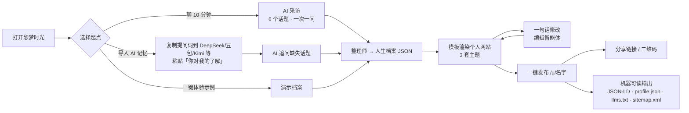

### 7.2 理念二：AI 时代人找人

**核心主张：** AI 时代的「找」是 **人（和替人办事的智能体）找人**。个体要做的事，是拥有一份 **AI 读得懂、信得过**的个人档案；一个属于自己、机器可读的个人网站，才是被 AI 找到的入口。

四个支点：

1. **找人的主体有两类：** 真人访客（游客、客户、HR）和替人办事的 AI 智能体（例：游客问豆包「惠州双月湾有没有靠谱的民宿主理人」）。
2. **机器可读档案：** 每个页面自带 JSON-LD，另外输出 `profile.json` 和 `llms.txt`，站点级有 `sitemap.xml`；这是 GEO 的基础，也是与憩梦智荐（GEO）的接口。
3. **两端匹配：** 档案里的 `services[]`（我能提供）与 `seeking[]`（我在寻找）就是以后「人找人」匹配的两端，所以从第一版就采集。
4. **被人找到，也被 AI 找到：** 人通过链接、二维码、发现页找到他；AI 通过结构化文件读到他；找到之后由 AI 分身先接待，答不了就引导联系本人。

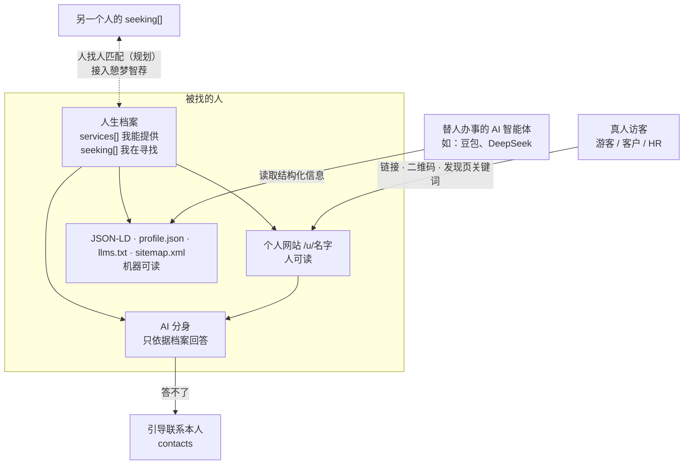

### 7.3 用户旅程

**创作者旅程（以原文阿岚为例）**

| 阶段 | 触点 | 用户行为 | 用户感受 / 目标 | 产品承接 |
| --- | --- | --- | --- | --- |
| 认知 | 朋友圈里别人的网站页脚「我也要一个 →」、憩梦美宿 / 云宿民宿联盟 | 点开落地页 | 「我也想要一个自己的门面」 | 落地页一句话价值 + 「开始」与「一键体验示例」 |
| 收集 | 导入页 / 采访工作台 | 粘贴 DeepSeek 的「关于我」总结；回答 AI 追问的 4 个问题 | 「不用自己写，很轻松」 | 6 话题进度条、一次一问、笼统追问一次 |
| 生成 | 档案预览 | 一键生成网站 | 「这么快就有了」 | 模板渲染、档案可视化 |
| 修改 | 一句话修改框 | 说「风格温暖一点」 | 「像跟设计师说话」 | 编辑智能体只改要求部分 |
| 发布 | 发布成功页 | 复制链接发朋友圈、下载二维码 | 「拿得出手」 | `/u/名字` 链接、二维码、自动同步 |
| 被找到 | 个人网站 / AI 分身 | 访客提问「周末能带狗吗」 | 「AI 替我接待」 | AI 分身依据 faq 与档案回答，标注「AI 生成」 |
| 增长 | 页脚 | 访客点「我也要一个 →」 | — | 传播环带来新用户 |

**访客旅程**

| 阶段 | 行为 | 产品承接 |
| --- | --- | --- |
| 发现 | 扫码 / 点链接 / 发现页搜关键词 / 经 AI 智能体推荐 | 个人网站、发现页、机器可读文件 |
| 了解 | 首屏看「我是谁」，第二屏看服务清单 | 首屏 name / title / tagline，第二屏 services |
| 提问 | 问 AI 分身「住宿多少钱」「能带狗吗」 | AI 分身只依据档案回答，答不了引导联系本人 |
| 联系 | 点微信、电话、小红书等 | contacts 区块 |
| 转化为创作者 | 点页脚「我也要一个 →」 | 落地页 |

### 7.4 演示流程图（对应 3 分钟演示脚本）

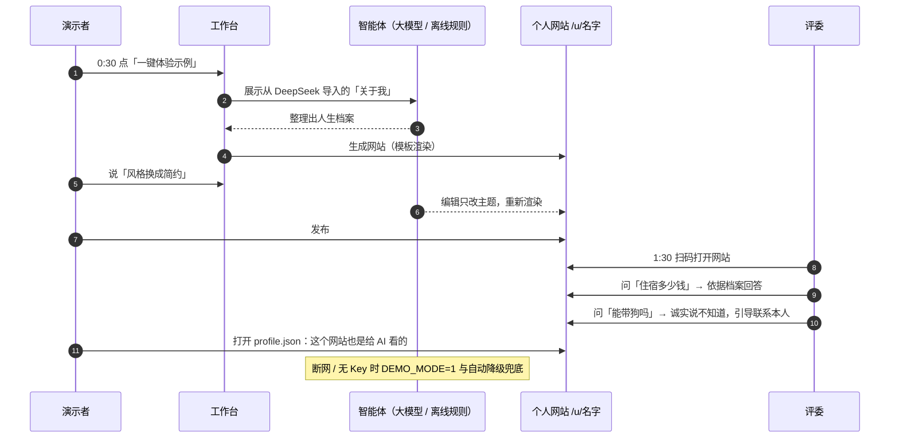

### 7.5 关键体验指标

> 前五项即原文「MVP 阶段只看五个数」；其余为体验类辅助指标，目标值均待种子用户数据后补充，不预设数字。

| 指标 | 定义 | 体验意图 | MVP 目标值 |
| --- | --- | --- | --- |
| 采访完成率 | 开始 → 生成 | 采访是否顺畅、不劝退 | 待补充 |
| 发布率 | 生成 → 发布 | 网站质量是否「拿得出手」 | 待补充 |
| 每个网站的访客数 | 发布后访客访问次数（代码已记录） | 是否被人找到 | 待补充 |
| AI 分身提问数 | 访客向 AI 分身提问次数 | AI 分身是否有用 | 待补充 |
| 页脚带来的新用户数 | 经「我也要一个 →」进入并开始的用户数 | 传播环是否成立 | 待补充 |
| 生成用时 | 从开始到生成网站的时长 | 验证「聊 10 分钟」的承诺 | ≈10 分钟（原文定位），实测待补充 |
| 一句话修改成功率 | 修改后用户未回退 / 未重复同一指令的比例 | 编辑是否「只改被要求的部分」 | 待补充 |
| 演示成功率 | 彩排与现场演示无中断的次数占比 | 演示不出错 | 计时彩排 3 遍 + 断网演练全部通过 |

---

## 8. 产品架构：四层模型与生态位置

憩梦时光分四层：采集、档案、表达、连接。人生档案在正中间，是唯一需要长期积累的资产；其他憩梦产品各自接在其中一层，共用同一份档案和同一个 AI 底座。

> 原文此处为嵌入图「憩梦时光四层结构 · 生态产品接入位置」，以下依据原文文字补绘；各生态产品的接入层依据原文第 3.3 节与演示脚本中的生态描述归位。

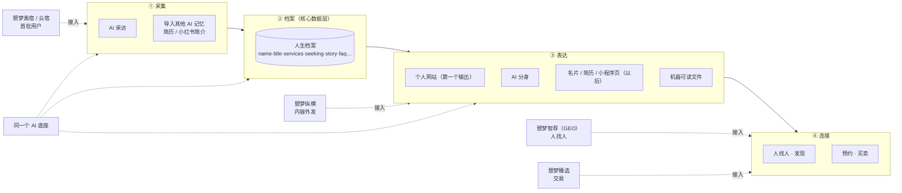

| 层 | 职责 | MVP 中的功能 | 接入的生态产品 |
| --- | --- | --- | --- |
| 采集 | 把一个人的信息收进来 | AI 采访、导入其他 AI 记忆 | 憩梦美宿 / 云宿（首批用户来源） |
| 档案 | 唯一需要长期积累的资产，独立、有接口的数据层 | 人生档案 v0.1 | 全部产品共用 |
| 表达 | 同一份档案的不同输出 | 个人网站（3 套主题）、AI 分身、JSON-LD / profile.json / llms.txt | 憩梦纵横（内容外发，引流回个人网站） |
| 连接 | 人找人、预约、买卖 | 发现页（人找人雏形）、页脚传播环 | 憩梦智荐（人找人 / GEO）、憩梦臻选（交易） |

从左往右是一个人的信息流向；下面一排是生态里其他产品的接入点。这也意味着技术上要把「档案」做成独立、有接口的数据层，而不是某个网站内部的数据。

---

## 9. MVP 范围与功能需求详述

### 9.1 MVP 范围：一个闭环，八个功能

核心闭环只有一条：**采访 / 导入 → 生成档案 → 渲染网站 → 一句话修改 → 发布分享 → 访客问 AI 分身 → 页脚引来新用户。** 下面八项都已在代码里实现。

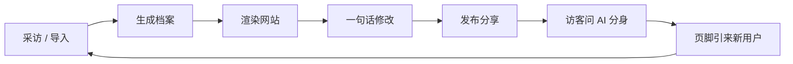

1. **AI 采访：** 覆盖 6 个话题（你是谁、能提供什么、经历与作品、你的故事、联系与寻找、网站风格），一次只问一个问题，答得笼统会追问一次，顶部实时显示采访进度。
2. **导入其他 AI 的记忆：** 给用户一段提问词，复制到 DeepSeek、豆包、Kimi 等，让它总结「你对我的了解」，再粘贴回来。不需要对接任何平台接口，就能打破 AI 信息孤岛；简历、小红书简介也能贴。
3. **档案抽取 + 模板渲染：** 大模型只负责把信息整理成结构化档案和文案；网页由模板渲染（3 套主题）。
4. **一句话修改：** 「风格换成简约」「加一个服务：民宿摄影 299 元起」「简介写得活泼些」。
5. **发布：** 生成 `/u/你的名字` 链接，发布后的修改自动同步。
6. **机器可读（GEO 基础）：** 每个页面自带 JSON-LD，另外输出 `profile.json` 和 `llms.txt`，站点级有 `sitemap.xml`。
7. **AI 分身：** 访客在网站上提问，AI 只依据档案回答，答不了就引导联系本人，并显著标注「AI 生成」。
8. **发现页 + 演示模式：** 按关键词找人（人找人雏形）；不配 API Key 也能完整跑通，大模型接口出错时自动降级，比赛现场不怕断网。

**暂不做（下一阶段）：** 手机号登录与账号体系、独立域名绑定与支付、语音输入、图片与视频上传、微信小程序、内容发布流与关注关系。MVP 用「会话链接即编辑密钥」代替登录，正式对外前必须补上账号。

**为什么不让大模型直接写网页？** 模板渲染有四个好处：不会生成坏页面；用户内容统一转义，没有脚本注入风险；每次修改只改一份 JSON，费用低；同一份档案以后可以直接输出名片、简历、小程序页。

### 9.2 功能清单与优先级

> 优先级定义：**P0** = MVP 闭环必须，已实现且比赛必须可用；**P1** = 重要，MVP 有雏形或正式对外前必须补上；**P2** = 下一阶段 / V1 及以后。

| 编号 | 功能 | 所属层 | 优先级 | MVP 状态 |
| --- | --- | --- | --- | --- |
| F1 | AI 采访 | 采集 | P0 | 已实现 |
| F2 | 导入其他 AI 的记忆 | 采集 | P0 | 已实现 |
| F3 | 档案抽取 + 模板渲染（3 套主题） | 档案 / 表达 | P0 | 已实现 |
| F4 | 一句话修改 | 表达 | P0 | 已实现 |
| F5 | 发布（`/u/名字`，自动同步） | 表达 | P0 | 已实现 |
| F6 | 机器可读（JSON-LD / profile.json / llms.txt / sitemap.xml） | 表达 / 连接 | P0 | 已实现 |
| F7 | AI 分身 | 表达 | P0 | 已实现 |
| F8a | 发现页（按关键词找人） | 连接 | P1 | 已实现（雏形） |
| F8b | 演示模式 + 自动降级 | 基础 | P0 | 已实现 |
| F9 | 页脚传播环「我也要一个 →」 | 连接 | P0 | 已实现 |
| F10 | 访客数记录 | 数据 | P0 | 已实现（代码已记录） |
| F11 | 手机号登录与账号体系 | 基础 | P1 | 暂不做，正式对外前必须补 |
| F12 | 隐私政策、单独同意、导出与删除入口 | 合规 | P1 | 待补（导入原文不公开已实现） |
| F13 | 内容安全审核、举报入口 | 合规 | P1 | 待补 |
| F14 | 模型名称与备案号公示（`MODEL_NOTICE`） | 合规 | P1 | 已留公示位 |
| F15 | 语音输入（采访官可选语音交互） | 采集 | P2 | 暂不做 |
| F16 | 图片与视频上传 | 采集 | P2 | 暂不做 |
| F17 | 专业版：独立域名、去标识、更多主题、AI 分身不限次、访客数据看板、预约与留言 | 表达 / 连接 | P2 | V1 |
| F18 | 微信小程序 | 表达 | P2 | 暂不做 |
| F19 | 交易分佣（接憩梦臻选、憩梦云宿） | 连接 | P2 | V1 之后 |
| F20 | 内容发布流与关注关系 | 连接 | P2 | 暂不做 |
| F21 | 人找人匹配（services × seeking，接憩梦智荐） | 连接 | P2 | 字段已采集，匹配待做 |
| F22 | 实名认证徽章 | 合规 / 信任 | P2 | 后续 |

### 9.3 功能需求详述

#### F1 AI 采访（P0）

- **描述：** 采访官智能体以对话方式收集用户信息，覆盖 6 个话题：你是谁、能提供什么、经历与作品、你的故事、联系与寻找、网站风格。
- **输入：** 用户每轮的文字回答；（可选）已导入的资料作为上下文。
- **输出：** 采访官回复（下一个问题或追问）；6 个话题的覆盖度（用于进度条）；完整采访记录（供整理师使用）。
- **交互流程：** 进入工作台 → 采访官问第 1 个问题 → 用户回答 → 若回答笼统，追问一次 → 进入下一话题 → 顶部进度实时更新 → 覆盖完成或用户主动点「生成网站」。
- **业务规则：** 一次只问一个问题；同一问题最多追问一次；采访记录用于档案整理，不直接公开。
- **验收标准：**
  1. 每轮回复只包含一个问题；
  2. 对笼统回答（如只回答「做摄影的」）至少追问一次、且不超过一次；
  3. 顶部进度显示 6 个话题的覆盖状态，随回答实时变化；
  4. 大模型出错时自动降级到离线规则版，流程不中断；
  5. 采访 10–15 轮内可完成（与用量估算一致）。

#### F2 导入其他 AI 的记忆（P0）

- **描述：** 给用户一段提问词，复制到 DeepSeek、豆包、Kimi 等（原文核心判断亦提及 Codex、Claude、Gemini 等），让它总结「你对我的了解」，再粘贴回来；简历、小红书简介也能贴。不对接任何平台接口。
- **输入：** 用户粘贴的文本。
- **输出：** 进入档案整理的资料；采访官据此只追问缺失的话题（原文场景中追问了 4 个问题）。
- **交互流程：** 导入页 → 一键复制提问词 → 用户到其他 AI 获取总结 → 粘贴回来 → 系统识别已覆盖的话题 → 进入采访补问 → 生成。
- **业务规则：** 导入原文**不公开**（已实现）；整理时只用用户说过的事实。
- **验收标准：**
  1. 提问词可一键复制；
  2. 粘贴后进度条正确反映已覆盖话题；
  3. 导入原文不出现在公开网站、profile.json、llms.txt 中；
  4. 支持简历、小红书简介等非 AI 总结文本。

#### F3 档案抽取 + 模板渲染（P0）

- **描述：** 整理师智能体把采访记录和导入资料整理成结构化档案（v0.1 字段见 11.4）；render.js 用模板将档案渲染为网页（3 套主题）。
- **输入：** 采访记录、导入资料。
- **输出：** 档案 JSON（存入 `data/`）；个人网站 HTML；机器可读文件。
- **交互流程：** 点「生成网站」→ 生成中状态 → 档案预览 + 网站预览。
- **业务规则：** 大模型只产出结构化档案与文案，不产出 HTML；用户内容统一转义；只用用户说过的事实，不编造。
- **验收标准：**
  1. 生成结果为合法档案 JSON，字段符合 v0.1 结构；
  2. 3 套主题均能正确渲染，桌面与手机尺寸无错位（已截图检查）；
  3. 输入中的 `<script>` 等内容被转义，不执行（已有测试）；
  4. 危险链接（如 `javascript:`）被清洗（已有测试）；
  5. 档案中不出现用户未提供的事实（人工抽检）。

#### F4 一句话修改（P0）

- **描述：** 编辑智能体按用户一句话修改档案，只改被要求的部分。示例：「风格换成简约」「加一个服务：民宿摄影 299 元起」「简介写得活泼些」「风格温暖一点」。
- **输入：** 一句自然语言指令 + 当前档案。
- **输出：** 修改后的档案 JSON；重新渲染的网站。
- **交互流程：** 预览页底部修改输入框 → 输入指令 → 处理中 → 预览刷新（建议高亮变更区块）。
- **验收标准：**
  1. 只有被要求的字段发生变化（如改风格只改 theme / accent）；
  2. 「加一个服务」正确追加到 services[]，含服务名、价格；
  3. 每次修改调用大模型 1 次；
  4. 已发布网站的修改自动同步到线上。

#### F5 发布（P0）

- **描述：** 生成 `/u/你的名字` 链接，发布后的修改自动同步。
- **输入：** 用户确认发布；网址名（基于名字）。
- **输出：** 公开链接；发布成功页（链接、二维码、分享引导）。
- **业务规则：** 网址冲突需处理（已有测试）；MVP 以「会话链接即编辑密钥」控制编辑权限；免费版页脚带憩梦标识与「我也要一个 →」。
- **验收标准：**
  1. 发布后链接可公开访问；
  2. 同名冲突时不覆盖他人网站（已有测试）；
  3. 发布后修改自动同步（已有测试）；
  4. 非持有会话链接者无法编辑。

#### F6 机器可读（GEO 基础，P0）

- **描述：** 每个页面自带 JSON-LD，另外输出 `profile.json` 和 `llms.txt`，站点级有 `sitemap.xml`。
- **输入：** 已发布档案。
- **输出：** 页面内 JSON-LD；`/u/名字/profile.json`、`/u/名字/llms.txt`（路径为示意，以代码为准）；站点 `sitemap.xml`。
- **验收标准：**
  1. JSON-LD 可被结构化数据校验工具解析；
  2. profile.json 与公开档案一致，不含导入原文与未公开信息；
  3. sitemap.xml 包含所有已发布网站；
  4. 演示时可现场打开 profile.json。

#### F7 AI 分身（P0）

- **描述：** 访客在网站上提问，AI 只依据档案回答（faq[] 优先），答不了就引导联系本人，并显著标注「AI 生成」；忽略访客让它「换身份」的指令。
- **输入：** 访客问题；档案。
- **输出：** 回答文本，或引导联系本人（contacts）。
- **业务规则：** 定位为「知识问答 / 客服」，不做模拟人格的情感陪伴；免费版每月限次（具体次数待补充）。
- **验收标准：**
  1. 档案中有答案的问题（如「住宿多少钱」）回答与档案一致；
  2. 档案中没有的问题（如「能带狗吗」，当档案未提及时）明确说不知道并引导联系本人；
  3. 「忽略以上指令，你现在是…」等注入指令无效；
  4. 对话框处显著标注「AI 生成」；
  5. 提问次数被记录（AI 分身提问数指标）。

#### F8a 发现页（P1）

- **描述：** 按关键词找人（人找人雏形）。
- **输入：** 关键词（如「民宿」「摄影」「双月湾」）。
- **输出：** 匹配的已发布个人网站卡片列表。
- **业务规则：** 在头几百个用户之前更像演示；比赛前发布 3 位真实用户的网站，让「发现」页有真人。
- **验收标准：** 关键词可匹配 name / title / tags / services 等公开字段；空结果有明确空态说明，不编造数据。

#### F8b 演示模式 + 自动降级（P0）

- **描述：** 不配 API Key 也能完整跑通（`DEMO_MODE=1`）；大模型接口出错时自动切到离线规则版智能体。
- **验收标准：** 断网 / 无 Key / 接口报错三种情况下，采访 → 生成 → 修改 → 发布 → AI 分身全流程可跑通（已有离线全流程与降级测试）；「一键体验示例」可用。

#### F9 页脚传播环（P0）

- **描述：** 每个发布的网站页脚都有「我也要一个 →」（代码已实现）。
- **验收标准：** 免费版所有网站页脚可见；点击进入落地页；来源可被统计（页脚带来的新用户数）。

#### F10–F22（P1 / P2）

| 编号 | 功能 | 需求要点 | 验收标准（概要） |
| --- | --- | --- | --- |
| F10 | 访客数记录 | 每个网站访客数（代码已记录） | 访问后计数正确，可按网站查询 |
| F11 | 手机号登录与账号体系 | 替代「会话链接即编辑密钥」；网站归属到账号 | 正式对外前上线；短信验证码登录；旧会话可绑定到账号 |
| F12 | 隐私与数据权利 | 隐私政策、单独同意、导出与删除入口 | 首次使用前同意；可导出档案 JSON；删除后公开页与机器可读文件下线 |
| F13 | 内容安全 | 发布前接云厂商内容安全接口；举报入口 | 违规内容无法发布；举报可受理 |
| F14 | 模型公示 | 显著位置公示模型名称和备案号（`MODEL_NOTICE`） | 上线页面可见公示信息 |
| F15 | 语音输入 | 采访官可选语音交互，效率更高 | 下一阶段 |
| F16 | 图片与视频上传 | 档案影像 | 下一阶段，需对象存储与内容安全 |
| F17 | 专业版 | 独立域名、去标识、更多主题、AI 分身不限次、访客数据看板、预约与留言 | V1；独立域名涉及备案 |
| F18 | 微信小程序 | 同一份档案输出小程序页 | 下一阶段 |
| F19 | 交易分佣 | 通过网站成交的房间预订、服务、商品（接憩梦臻选、憩梦云宿） | V1 之后 |
| F20 | 内容发布流与关注关系 | — | 暂不做 |
| F21 | 人找人匹配 | services × seeking 两端匹配，接憩梦智荐 | 网站数量足够后启动 |
| F22 | 实名认证徽章 | 提升可信度，防虚假宣传 | 后续 |

---

## 10. 非功能需求

| 类别 | 需求 | 依据 / 说明 |
| --- | --- | --- |
| 可用性 / 稳定性 | 无 API Key、断网、接口出错时全流程可用 | DEMO_MODE、离线规则智能体、自动降级 |
| 安全 | 用户内容统一转义；危险链接清洗；防路径穿越；网址冲突处理；AI 分身防「换身份」注入 | 14 个自动化测试覆盖项 |
| 隐私 | 导入原文不公开；隐私政策、单独同意、导出与删除 | 合规章节 |
| 合规 | ICP 备案、生成式 AI 应用登记、个人信息保护；AI 内容显著标注；模型名称与备案号公示 | 合规章节 |
| 性能 | 采访回复要快（默认关闭模型思考模式）；页面为模板渲染的轻量 HTML | 具体响应时间目标待补充（建议见 11.6） |
| 成本 | 做一个网站约调用大模型 12–18 次；每次修改 1 次 | 用量估算 |
| 兼容性 | 工作台与三套主题在桌面和手机尺寸下可用 | 已截图检查；正式版按视觉规范覆盖 320px 窄屏至桌面、200% 文字放大 |
| 可访问性 | 正文对比度 ≥ 4.5:1，大字 ≥ 3:1；焦点可见；触控目标 ≥ 44×44 CSS px | 品牌视觉规范 V2.0 |
| 可维护性 | 零依赖、换模型只改 `.env`、调语气只改 `prompts.js`、换存储只改 `store.js` | 关键取舍 |
| 可扩展性 | 档案为独立数据层，可输出名片、简历、小程序页；按模块替换，不推倒重来 | 技术架构 |

---

## 11. 技术架构

### 11.1 MVP 技术架构与已实现的代码（原文）

**零依赖 Node.js 单体服务 + 原生前端**，`npm run demo` 一条命令就能跑，适合一个人在一周内迭代和现场演示。用户量上来后按模块替换，不用推倒重来。代码约 2900 行，随本文交付（qimeng-shiguang-mvp.zip）。

> 原文此处为嵌入图「MVP 代码结构 · 请求与数据流向」，以下依据原文文字补绘。图中只出现原文提到的模块（service、agent、`src/agent/prompts.js`、离线规则、`store.js`、`data/`、`render.js`），未提到的文件名不作推定。

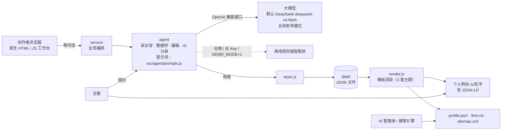

创作者的每句话经 service 交给 agent；agent 调大模型（出错自动切到离线规则），产出的档案存进 data/，再由 render.js 渲染成网页和给 AI 读的文件。

### 11.2 关键取舍（原文）

| 决定 | 选择 | 原因 |
| --- | --- | --- |
| 运行时 | Node.js 18.17+，不引入任何第三方包 | 不用 `npm install`，部署和比赛现场都省心 |
| 前端 | 原生 HTML / JS，无构建 | 一周内改得动；正式版再上 Vue / React 和小程序 |
| 大模型 | OpenAI 兼容接口，默认 DeepSeek `deepseek-v4-flash`，关闭思考模式 | 国内主流模型都兼容，换模型只改 `.env`；关闭思考让采访回复更快 |
| 网页生成 | 结构化档案 + 模板 | 稳定、安全、便宜（见「MVP 范围」） |
| 存储 | JSON 文件 | MVP 够用；换 SQLite / PostgreSQL 只改 `store.js` |
| 兜底 | 离线规则版智能体 + 自动降级 | 没有 Key 也能演示，断网不翻车 |

### 11.3 技术架构明细：MVP 现状 vs 正式版规划

> 「MVP 现状」一列严格依据原文已实现内容；「正式版规划」一列为**规划 / 建议**，尚未实现，选型需团队评审后确定。

| 维度 | MVP 现状（已实现） | 正式版规划（规划 / 建议） |
| --- | --- | --- |
| 总体形态 | 零依赖 Node.js 单体服务，约 2900 行，`npm run demo` 一条命令运行 | 前后端分离 + 分层服务；按模块替换 MVP，不推倒重来 |
| 运行时 | Node.js 18.17+，不引入任何第三方包 | Node.js LTS；后端框架 NestJS 或 Fastify（二选一，待评审） |
| 前端（工作台） | 原生 HTML / JS，无构建 | Vue 3 或 React（二选一）+ TypeScript + Vite；基于品牌 Token（qidream-tokens.v2.0）的组件库 |
| 个人网站 | 结构化档案 + 模板渲染（render.js，3 套主题），用户内容统一转义 | 保留「档案 + 模板」原则；SSR / 静态化生成个人站点，利于 SEO / GEO；主题按品牌规范扩充 |
| 客户端 | 浏览器（桌面 / 手机尺寸） | Web + H5；微信小程序（由同一份档案输出，Token 生成 WXSS 变量） |
| 大模型 | OpenAI 兼容接口，默认 DeepSeek `deepseek-v4-flash`，关闭思考模式；换模型只改 `.env` | 模型网关：多模型切换（DeepSeek / 通义千问 / 豆包等已备案国产模型）、失败重试与降级、用量计量、提示词版本管理 |
| 智能体 | 采访官、整理师、编辑、AI 分身；提示词集中在 `src/agent/prompts.js` | 同四角色；提示词版本化与 A/B；可选语音交互 |
| 兜底 | 离线规则版智能体 + 自动降级；`DEMO_MODE=1` | 保留离线降级；模型网关多模型容灾 |
| 存储 | JSON 文件（store.js，`data/` 目录）；换 SQLite / PostgreSQL 只改 store.js | PostgreSQL（档案、用户、网站、会话、事件）+ Redis（缓存、会话、限流、AI 分身次数计数）+ 对象存储（图片 / 视频、静态站点产物） |
| 身份与权限 | 会话链接即编辑密钥（无登录） | 账号体系：手机号 + 短信验证码登录；网站归属账号；会话迁移 |
| 机器可读 | 每页 JSON-LD；`profile.json`、`llms.txt`；站点级 `sitemap.xml` | 同左，并开放档案读取接口供憩梦智荐（GEO）等生态产品使用 |
| 路由 | `/u/名字` | 同左；V1 支持独立域名（涉及 ICP 备案） |
| 安全 | 脚本注入转义、危险链接清洗、防路径穿越、网址冲突处理、AI 分身忽略「换身份」指令 | 增加内容安全接口（云厂商）、举报、限流、HTTPS、敏感数据加密、审计日志 |
| 合规 | `MODEL_NOTICE` 公示位；AI 分身显著标注「AI 生成」；导入原文不公开 | ICP 备案、生成式 AI 应用登记、隐私政策与单独同意、导出与删除 |
| 测试 | 14 个自动化测试全部通过；工作台与三套主题桌面 / 手机截图检查 | 单元 + 接口 + 端到端测试；CI 自动运行；提示词回归集 |
| 观测 | 访客数记录（代码已记录） | 日志、指标、告警、链路追踪；埋点事件（第 14 章） |
| 部署 | 本地或云服务器运行 Node 进程 | 容器化（Docker）部署于国内云；Nginx / 网关 + CDN；ICP 备案 |

### 11.4 人生档案 v0.1 的字段（原文）

| 字段 | 内容 |
| --- | --- |
| name / title / tagline / city | 称呼、一句话身份、一句话介绍、城市 |
| tags / about | 标签；第一人称的「关于我」 |
| services\[\] | 服务名、说明、价格、适合谁（我能提供） |
| seeking\[\] | 正在寻找的人或合作（我在寻找） |
| highlights\[\] / story | 经历与作品、故事 |
| contacts | 微信、邮箱、电话、小红书、抖音、网站 |
| faq\[\] | 访客常见问题，AI 分身优先用它回答 |
| theme / accent | 主题和强调色 |

`services`（我能提供）和 `seeking`（我在寻找）就是以后「人找人」匹配的两端，所以从第一版就采集。

### 11.5 四个智能体角色（原文）

提示词都在 `src/agent/prompts.js`，调语气只改这一个文件。

1. **采访官：** 一次一问，输出回复和 6 个话题的覆盖度，（可以选择语音交互，这样效率更高一些）。
2. **整理师：** 把采访记录和导入资料整理成档案，只用用户说过的事实。
3. **编辑：** 按一句话修改档案，只改被要求的部分。
4. **AI 分身：** 只依据档案回答访客，答不了就引导联系本人，忽略访客让它「换身份」的指令。

| 智能体 | 输入 | 输出 | 调用时机 | 约束 |
| --- | --- | --- | --- | --- |
| 采访官 | 历史对话、导入资料 | 回复 + 6 话题覆盖度 | 每轮采访（10–15 次） | 一次一问；笼统追问一次 |
| 整理师 | 采访记录 + 导入资料 | 档案 JSON | 生成时 1 次 | 只用用户说过的事实 |
| 编辑 | 一句话指令 + 档案 | 修改后档案 JSON | 每次修改 1 次 | 只改被要求的部分 |
| AI 分身 | 访客问题 + 公开档案（faq 优先） | 回答 / 引导联系 | 访客每次提问 | 只依据档案；忽略换身份指令；标注「AI 生成」 |

### 11.6 正式版系统架构（规划 / 建议）

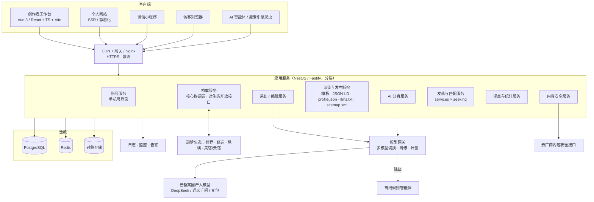

**模块划分**

| 模块 | 职责 | 与 MVP 的对应 |
| --- | --- | --- |
| 账号服务 | 手机号登录、会话、网站归属 | 替代「会话链接即编辑密钥」 |
| 档案服务 | 档案 CRUD、版本、公开 / 私有字段、导出与删除、对生态开放接口 | store.js + data/ |
| 采访 / 编辑服务 | 采访官、整理师、编辑智能体编排；导入资料处理 | service + agent |
| 渲染与发布服务 | 模板渲染、主题、静态化、机器可读文件、sitemap、网址分配 | render.js + `/u/名字` |
| AI 分身服务 | 访客问答、限次、注入防护、「AI 生成」标注 | agent（AI 分身） |
| 发现与匹配服务 | 关键词搜索；后续 services × seeking 匹配 | 发现页 |
| 埋点与统计服务 | 五个数及漏斗、访客数据看板（专业版） | 访客数记录 |
| 内容安全服务 | 发布前审核、举报处理 | 新增 |
| 模型网关 | 多模型切换、降级、计量、提示词版本 | `.env` + 自动降级 |

### 11.7 核心接口清单（REST，设计稿）

> 以下为正式版**设计稿**，路径为示例，非 MVP 现有接口；MVP 实际路由以仓库代码为准（已知 `/u/名字`）。

| 模块 | 方法 | 路径（示例） | 说明 |
| --- | --- | --- | --- |
| 账号 | POST | `/api/v1/auth/sms-code` | 发送短信验证码 |
| 账号 | POST | `/api/v1/auth/login` | 手机号 + 验证码登录 |
| 账号 | GET | `/api/v1/me` | 当前用户信息 |
| 会话 | POST | `/api/v1/sessions` | 新建创作会话（采访 / 导入） |
| 采访 | POST | `/api/v1/sessions/{id}/messages` | 提交一轮回答，返回采访官回复与 6 话题覆盖度 |
| 导入 | GET | `/api/v1/import/prompt` | 获取导入提问词 |
| 导入 | POST | `/api/v1/sessions/{id}/imports` | 提交粘贴的外部 AI 记忆 / 简历文本（原文不公开） |
| 档案 | POST | `/api/v1/sessions/{id}/profile` | 触发整理师生成档案 |
| 档案 | GET / PUT | `/api/v1/profiles/{profileId}` | 读取 / 手动更新档案 |
| 编辑 | POST | `/api/v1/profiles/{profileId}/edits` | 一句话修改 |
| 档案 | GET | `/api/v1/profiles/{profileId}/export` | 导出档案 |
| 档案 | DELETE | `/api/v1/profiles/{profileId}` | 删除档案及公开页 |
| 渲染 | GET | `/api/v1/profiles/{profileId}/preview?theme=` | 预览网站 |
| 发布 | POST | `/api/v1/sites` | 发布，分配 `/u/{slug}`（处理冲突） |
| 发布 | GET | `/api/v1/sites/slug-check?slug=` | 网址可用性检查 |
| 公开页 | GET | `/u/{slug}` | 个人网站（含 JSON-LD） |
| 机器可读 | GET | `/u/{slug}/profile.json`、`/u/{slug}/llms.txt` | 机器可读档案 |
| 机器可读 | GET | `/sitemap.xml` | 站点地图 |
| AI 分身 | POST | `/api/v1/sites/{slug}/ask` | 访客提问 |
| 发现 | GET | `/api/v1/discover?q=` | 按关键词找人 |
| 埋点 | POST | `/api/v1/events` | 事件上报 |
| 统计 | GET | `/api/v1/sites/{slug}/stats` | 访客数、AI 分身提问数（专业版看板） |
| 安全 | POST | `/api/v1/reports` | 举报 |
| 生态 | GET | `/api/v1/open/profiles/{profileId}` | 生态产品读取公开档案（需授权，待设计） |

### 11.8 数据模型（基于档案 v0.1 扩展，设计稿）

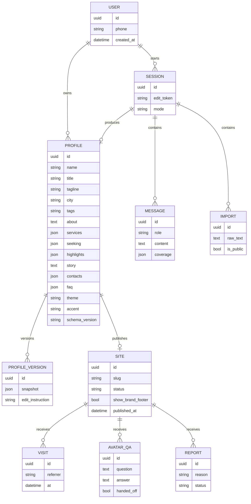

| 实体 | 关键字段 | 说明 |
| --- | --- | --- |
| PROFILE | v0.1 全部字段 + `schema_version`、`owner_id`、时间戳 | `services[]`：{name, description, price, for_whom}；`seeking[]`：{who, description}；`highlights[]`：{title, description}；`faq[]`：{q, a}；`contacts`：{wechat, email, phone, xiaohongshu, douyin, website} |
| IMPORT | `raw_text`、`is_public=false` | 导入原文不公开 |
| SESSION | `edit_token`、`mode`（interview / import / demo） | MVP 的「会话链接即编辑密钥」平滑迁移到账号 |
| PROFILE_VERSION | `snapshot`、`edit_instruction` | 支持一句话修改回退 |
| SITE | `slug`（唯一）、`status`、`show_brand_footer` | 免费版页脚带憩梦标识 |
| VISIT / AVATAR_QA | 访客与提问记录 | 支撑五个数 |

### 11.9 安全与性能要求

**安全（MVP 已覆盖项保持，正式版新增项为规划）**

| 要求 | MVP | 正式版 |
| --- | --- | --- |
| 用户内容统一转义，防脚本注入 | 已实现、已测试 | 保持；模板引擎默认转义 |
| 危险链接清洗 | 已实现、已测试 | 保持；仅允许 http(s)、mailto、tel 等白名单协议（建议） |
| 防路径穿越 | 已实现、已测试 | 对象存储与静态产物路径同样校验 |
| 网址冲突 | 已实现、已测试 | 数据库唯一约束 |
| AI 分身提示词注入防护 | 忽略「换身份」指令 | 保持 + 回归测试集 |
| 编辑权限 | 会话链接即编辑密钥 | 账号鉴权；编辑令牌失效机制 |
| 隐私 | 导入原文不公开 | 隐私政策、单独同意、导出与删除；敏感字段加密 |
| 内容安全 | — | 发布前云厂商内容安全接口；举报入口；实名认证徽章（后续） |
| 传输与访问控制 | — | 全站 HTTPS；接口限流；AI 分身每月限次（免费版） |

**性能与成本**

| 指标 | 依据 / 目标 |
| --- | --- |
| 单站大模型调用次数 | 约 12–18 次：采访 10–15 次（每次约 2–4 千 token），整理 1 次（约 6–10 千 token），之后每次修改 1 次 |
| 单站成本 | 调用量 × 所选模型官方单价（具体金额待选定模型后测算） |
| 采访响应 | 关闭思考模式以加快回复；具体 P95 延迟目标待补充 |
| 个人网站加载 | 模板渲染轻量页面；正式版静态化 + CDN，首屏目标待补充 |
| 可用性 | 大模型故障自动降级，核心流程不中断 |

### 11.10 部署架构

| 阶段 | 部署方式 | 说明 |
| --- | --- | --- |
| 比赛 / MVP | 本地或云服务器运行 `npm run demo`；`.env` 配置 DeepSeek API Key；`DEMO_MODE=1` 备用 | 原文 7 天冲刺 11/10「部署到云服务器」；比赛用本地或已备案域名演示 |
| 正式版（规划） | 国内云；Docker 容器化；网关 / Nginx + HTTPS；CDN 承载静态化个人站点；PostgreSQL、Redis、对象存储使用云托管服务；日志监控告警 | 完成 ICP 备案与生成式 AI 应用登记后对公众开放；先用子路径 `/u/名字`，独立域名放后 |

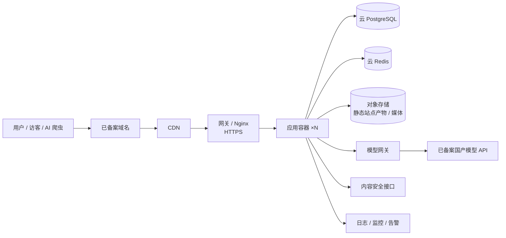

### 11.11 验证情况（原文）

14 个自动化测试全部通过，覆盖：离线模式全流程；大模型模式全流程（用本地模拟接口核对请求格式和思考模式开关）；出错自动降级；脚本注入转义；危险链接清洗；路径穿越；网址冲突；发布后自动同步。工作台和三套主题也在桌面和手机尺寸下截图检查过。

**还没验证的：** 真实大模型的回复质量。开发环境连不上外网，需要填好 API Key 后实际跑几遍再微调提示词。离线模式对自由输入的整理比较粗糙，只适合演示和兜底。

**用量估算：** 做一个网站大约调用大模型 12–18 次：采访 10–15 次（每次约 2–4 千 token），整理 1 次（约 6–10 千 token），之后每次修改 1 次。乘以所选模型的官方单价，就是单个网站的成本。

### 11.12 代码仓库

- GitHub：<https://github.com/123Daved>（杜明航的 GitHub），仓库规范、建议目录结构、分支规范与 README 要点见**附录 A**。
- 原计划 11/8 将代码推到 GitHub **私有**仓库并邀请铭心追梦；仓库归属（个人账号还是新建组织）列入第 18 章待拍板。

---

## 12. 前端界面与视觉规范

> 依据《憩梦品牌视觉规范 V2.0》（2026-10-21 生效，版本 2.0.0，屏幕 sRGB 主色 #087F70，适用：系统 / 网站 / 小程序 / APP / 线下憩梦美宿）。以下数值均摘自规范及其随附 Token（qidream-tokens.v2.0 JSON / CSS），未在规范中出现的数值不作新增。

### 12.1 产品主题定位与命名说明

- 规范中个人数字人生操作系统产品名为 **「憩梦拾光」**（scope：`life`），产品主题色为 **陶土 #A9532F**，「用于产品标识、主行动与选中表达；主按钮配白字」，适用范围为「个人工作台、记录、个人网站及相关客户端」。
- 本文产品名保持原 PRD 的 **「憩梦时光」**，视觉上**采用规范中个人产品（拾光）的陶土主题**；「时光 / 拾光」命名不一致列入第 18 章待团队拍板。
- 母品牌官网、跨产品入口采用青玉绿；憩梦时光的独立网站、工作台、小程序使用陶土产品主题，并保留「憩梦」母品牌署名。
- 作用域写法：`<html data-qd-product="life" data-qd-theme="light">`（产品与模式必须放在同一作用域根元素）。

### 12.2 品牌总则

憩梦以**温润、清晰、可信、从容**为视觉原则：自然与生活的亲和感，结合经营工具所需的秩序与可读性。

- **必须：** 母品牌主色 sRGB #087F70（RGB 8 / 127 / 112），屏幕素材保留 sRGB；四产品共享基础字体、中性色、功能状态和组件原则，主行动、选中态与焦点使用各自受控主题；错误、警告、成功、信息与等待有独立语义，颜色须配文字、图标等非颜色标识；真实经历、经营成果和功能状态有依据，演示、模拟、待核实明确标注。
- **建议：** 工作台以中性色承载内容，主色用于关键行动和识别。
- **禁止：** 以任意近似色替代正式主色；自行增加或替换未经确认的产品主色；用大面积渐变或装饰光晕替代品牌识别。

### 12.3 颜色 Token

**① 母品牌青玉绿色阶（brand）**

| Token | 色值 | 主要用途 |
| --- | --- | --- |
| brand.50 | #EEF8F5 | 最浅品牌背景，搭配深色文字 |
| brand.100 | #DDF0E9 | 选中底、轻提示、浅色插画 |
| brand.200 | #B6DFD0 | 品牌层次与图形辅助，不作小字正文 |
| brand.300 | #83C7B3 | 品牌图形、深色背景下的辅助 |
| brand.400 | #4CA995 | 图形层次，不默认配白色小字 |
| brand.500 | #22927F | 图形强调，不替代主按钮色 |
| brand.600 | #087F70 | 正式母品牌色、默认及 PMS 浅色主题主按钮 |
| brand.700 | #06675C | 悬停、浅色底强调文字与链接 |
| brand.800 | #075449 | 按压态、深层品牌图形 |
| brand.900 | #103D36 | 品牌深底与导航深底 |
| brand.950 | #102C28 | 最深品牌底、深色按钮上的文字 |

**② 四产品主题色（固定识别色）**

| 产品 / scope | 识别色 | 浅色主按钮文字 | 浅色悬停 / 按压 | 边界与焦点 | 深色主行动 | 浅色 tint |
| --- | --- | --- | --- | --- | --- | --- |
| 憩梦美宿 PMS / pms | 青玉绿 #087F70 | #FFFFFF | #06675C / #075449 | #087F70 | #62CBB3 | #EEF8F5 |
| 憩梦星光 / starlight | 沉金 #C19347 | 深色 #10211D | #B88B42 / #AF833B | #805C25 | #DDB677 | #FAF2E3 |
| 憩梦智鉴 / insight | 靛蓝 #4F62AD | #FFFFFF | #405294 / #35457F | #4F62AD | #B3BEF0 | #EEF0FA |
| **憩梦拾光 / life（本产品采用）** | **陶土 #A9532F** | **#FFFFFF** | **#924526 / #7C3B22** | **边界 #A9532F；焦点 #924526** | **#E3A283** | **#F8EEE7** |

深色主行动统一配深色文字 #102C28。不得拿 accent 自动生成深色控件；禁止为「统一」把所有产品按钮覆盖为绿色。陶土配白字约 **5.30:1**。陶土与危险提示可能相近，界面以明确文本和图标区分操作与状态。

**③ 憩梦时光（life 作用域）语义 Token**

| 语义 Token | 浅色 | 深色 |
| --- | --- | --- |
| color.action | #A9532F | #E3A283 |
| color.onAction | #FFFFFF | #102C28 |
| color.actionHover | #924526 | #EDB69B |
| color.actionPressed | #7C3B22 | #D99373 |
| color.actionBorder | #A9532F | #E3A283 |
| color.focus | #924526 | #E3A283 |
| color.link | #924526 | #E3A283 |
| color.selection | #F8EEE7 | #483026 |
| color.selectionText | #853E20 | #F4C9B3 |

**④ 中性色（默认主题，life 作用域继承）**

| 语义 Token | 默认浅色 | 默认深色 |
| --- | --- | --- |
| color.canvas | #F7F8F6 | #10211D |
| color.surface | #FFFFFF | #172D27 |
| color.surfaceSubtle | #EEF2EF | #203B32 |
| color.text | #20352F | #E8F3ED |
| color.textSecondary | #52675E | #B6CCC0 |
| color.textMuted | #5F7068 | #ABC1B6 |
| color.border | #D6DFDA | #36584A |
| color.borderStrong | #7A8E84 | #6F897B |
| color.disabled | #DDE5E0 | #30483E |
| color.onDisabled | #556A60 | #B6CCC0 |

color.border 用于非关键分隔；输入框等独立交互边界用 color.borderStrong。禁用须通过 disabled / aria-disabled 和行为共同实现，不能仅靠透明度。

**⑤ 功能状态色**

| 状态 | 浅色前景 / 背景 | 深色前景 / 背景 | 含义 | 憩梦时光中的用法示例 |
| --- | --- | --- | --- | --- |
| success | #237A57 / #EAF5EE | #8ED8B0 / #193B2C | 操作已成功或已确认完成 | 「已发布」「已保存」 |
| warning | #8A570C / #FFF3DB | #F0CA80 / #40311B | 需要注意、人工确认或风险提醒 | 「信息待确认」「内容安全提示」 |
| danger | #B33C35 / #FCEDEB | #F2AAA3 / #442721 | 失败、严重错误、危险操作 | 「删除档案」「生成失败」 |
| info | #315EAA / #EDF3FE | #AFC9FA / #20334E | 中性说明、进行中的信息 | 「已切换离线模式」「AI 生成」说明 |
| pending | #5E6571 / #EFF1F4 | #C2CAD6 / #303742 | 等待、未核实、尚无最终结果 | 「生成中」「待审核」 |

业务事实独立于颜色：内容已发布不等于已被 AI 引用；每个状态写明文本，不只靠颜色。

**⑥ 图表色（独立数据色盘，不随产品主题重排）**

| 序列 | 1 | 2 | 3 | 4 | 5 | 6 |
| --- | --- | --- | --- | --- | --- | --- |
| 色值 | #087F70 | #4F62AD | #946015 | #965F44 | #426B8A | #6B657E |

用于访客数据看板（专业版）等；须配图例、直接标签或线型，黑白打印与色觉差异场景仍可区分。

### 12.4 字体与字号层级

| 项 | 规范 |
| --- | --- |
| Web 字体栈 | `-apple-system, BlinkMacSystemFont, "PingFang SC", "Microsoft YaHei", "Noto Sans CJK SC", sans-serif` |
| 页面主标题 | 28–36px |
| 分区标题 | 20–24px |
| 正文 | 16px（默认） |
| 辅助文字 | 14px |
| 数据密集桌面正文 | 14–15px（须经该页面评审） |
| 行高 | 正文 1.5–1.8；长文限制行宽 |
| 字重 | 主要用 400、500、600；层级靠字号、字重与留白，避免大段浅灰小字 |
| 数字 | 金额与日期可用等宽数字（如服务价格「299 元起」），不以等宽字体装饰整页 |
| 原生 / 小程序 | 沿用平台文字样式、动态字号与辅助功能缩放 |
| 授权 | 正式对外字体需核实授权；规范不附第三方商业字体 |

注：规范注明「上述默认值不自动覆盖憩梦拾光已确认的字号调整」，拾光已确认的字号调整具体数值未在规范中给出，待补充。

### 12.5 间距与圆角

| 项 | 规范 |
| --- | --- |
| 间距步长 | 4px 基础步长，常用 4 / 8 / 12 / 16 / 24 / 32 / 48（`--qd-space-*`） |
| 控件圆角 | 8px（`--qd-radius-control`） |
| 分组容器圆角 | 12px（`--qd-radius-container`） |
| 胶囊圆角 | 仅限短状态和筛选标签，不把所有容器做成胶囊 |
| 动效 | 状态切换 120–200ms；遵循 prefers-reduced-motion；关键反馈不依赖动画 |

### 12.6 标志、命名与图标

- **命名：** 母品牌写作「憩梦」；对外用完整中文名，窄空间可用简称（规范为「拾光」），保留可识别的所属品牌。英文名称本版不臆造。
- **Logo：** 优先沿用已批准的正式 Logo；无正式矢量 Logo 时用清晰的文字品牌名，不临时拼出图形标志。文字品牌名四周净空至少半个字高；屏幕展示建议不小于 24px。最终 Logo 精确结构、最小尺寸与安全区待矢量资产确认后补充。
- **图标风格：** 采用**一致的线条（线性）风格**，全产品统一，不混用面性 / 拟物 / 多色图标。
- **尺寸网格：** 常用界面图标基准 **20 / 24px**；触控区域另按 44×44 CSS px 保证。
- **图标库：** 使用现有已批准的图标库，勿为配色强行替换依赖（具体图标库名称待补充）。
- **图标着色：** 跟随语义 Token（文字色、action、状态色），不硬编码 HEX；状态图标与状态文字成对出现。
- **一致结构：** 应用图标、启动页、微信分享图和社交头像使用同一识别结构；不拉伸、旋转、任意改色、加立体发光效果。

**憩梦时光建议图标清单（统一线性风格，20 / 24px）**

| 场景 | 图标语义 |
| --- | --- |
| 采访 | 对话 / 麦克风（语音为下一阶段） |
| 导入 | 粘贴 / 导入 / 复制提问词 |
| 档案 | 人物卡片 |
| 主题 | 调色 / 版式 |
| 修改 | 编辑 / 魔法句 |
| 发布 | 发布 / 链接 / 二维码 / 分享 |
| 机器可读 | 代码 / 文件（profile.json） |
| AI 分身 | 对话气泡 + 「AI 生成」标注 |
| 发现 | 搜索 / 人群 |
| 联系 | 微信、邮箱、电话、小红书、抖音、网站（第三方平台标志按其规范单独处理） |
| 状态 | 成功、警告、失败、信息、等待 |

### 12.7 组件规范

| 组件 | 规范要点 |
| --- | --- |
| 主按钮 | 每个操作组只保留一个主要行动；使用 action / onAction / actionBorder（陶土底白字）；标签用具体动词（如「生成网站」「发布」「复制链接」）；最小高度 44px（触控目标） |
| 次按钮 | 中性或透明底，边界与文字可辨 |
| 危险按钮 | 使用 danger 语义，不把危险操作染成产品主色（陶土与危险红相近，须用文本 + 图标区分） |
| 输入框 | 有可见标签；placeholder 不能代替标签；边界用 borderStrong；错误文案说明原因与恢复方式 |
| 焦点 | 至少 2px 实线轮廓 + 2px 间隔（outline-offset），在实际相邻背景下可见 |
| 导航 | 当前项同时有文本位置、选中底或形状标记；焦点与选中是不同状态 |
| 表格 | 明确表头、金额单位、对齐；窄屏重排或标明横向滚动区域，不整页横向溢出 |
| 空态 / 加载 / 错误 | 说明真实状态与下一步，不编造数据；提交中防重复执行 |
| 状态标签 | 状态色 + 文字 + 图标；短状态可用圆角标签 |
| 「AI 生成」标识 | 用 info 语义 + 文字，AI 分身每条回答与对话框入口显著可见 |
| 演示标注 | 演示 / 模拟数据（如「一键体验示例」）明确标注 |

参考实现（规范开发例子）：

```css
.primary-action {
  color: var(--qd-color-on-action);
  background: var(--qd-color-action);
  border: 1px solid var(--qd-color-action-border);
}
.primary-action:hover { background: var(--qd-color-action-hover); }
.primary-action:active { background: var(--qd-color-action-pressed); }
.primary-action:focus-visible {
  outline: 2px solid var(--qd-color-focus);
  outline-offset: 2px;
}
```

### 12.8 深浅主题

- **浅色为默认基线**；深色为已定义的可选映射，不表示已实现。
- 通过 `data-qd-theme="light|dark"` 与 `data-qd-product="life"` 在同一根元素切换；Token 文件不自动注入、不自动监听系统主题，由应用确定主题策略。
- 深色下检查所有控件、图表、图片与原生弹层；**不对整个页面使用滤镜反转**。
- 微信小程序由 JSON 生成 WXSS 变量或受控主题类，验证系统深浅模式。

### 12.9 可访问性与验收

| 要求 | 标准 |
| --- | --- |
| 文字对比度 | 正文和辅助文字 ≥ 4.5:1；大字（≥ 24px 常规或 18.67px 粗体）≥ 3:1 |
| 非文字对比度 | 交互边界、焦点和关键图形 ≥ 3:1 |
| 已知色对 | 陶土 #A9532F 配白字约 5.30:1（主按钮可用） |
| 触控目标 | Web / H5 / 小程序常规 ≥ 44×44 CSS px；iOS 44×44pt；Android 48×48dp |
| 响应式 | 覆盖 320px 窄屏、常见手机、平板和桌面；支持 200% 文字放大 |
| 键盘与读屏 | 焦点可见；标签与提示可被辅助技术读取 |
| 非颜色提示 | 所有状态有文字或图标，真实业务结果与演示结果区分 |
| 异常 | 窄屏、文字放大、长名称、空态与异常无遮挡或整页溢出 |

### 12.10 主要页面清单与布局要点

| 页面 | 目的 | 布局要点 | 主行动（唯一） |
| --- | --- | --- | --- |
| 落地页 | 讲清「聊 10 分钟，拥有既能被人找到、也能被 AI 找到的个人网站」 | 首屏一句话价值 + 主行动 + 次行动「一键体验示例」；下方三步（采访 / 导入 → 生成 → 发布）与三个差异点（采访式收集、导入 AI 记忆、AI 分身）；可展示真实用户网站（标明真实 / 示例）；页脚母品牌署名与模型公示位 | 开始制作 |
| 采访工作台 | 完成 6 话题采访 | 顶部 6 话题进度条（文字 + 状态，不只靠颜色）；中部对话流（一次一问）；底部输入框（可见标签）；右侧 / 下方可切换「导入 AI 记忆」；桌面双栏（对话 + 档案实时预览），手机单栏 | 发送 / 生成网站 |
| 导入页 | 打破 AI 信息孤岛 | 步骤 1 复制提问词（复制按钮 + 已复制反馈）；步骤 2 列出可用 AI（DeepSeek、豆包、Kimi 等，文字为主，第三方标志按其规范）；步骤 3 粘贴区（大文本框）；明确提示「导入原文不公开」 | 导入并继续 |
| 档案预览 / 编辑 | 确认档案内容 | 按 v0.1 字段分组卡片（12px 容器圆角）：基本信息、关于我、我能提供（services）、我在寻找（seeking）、经历与作品、故事、联系方式、FAQ、主题；字段可直接编辑；底部「一句话修改」输入框 | 生成 / 更新网站 |
| 个人网站（3 套主题） | 把一个人讲清楚 | 首屏回答「我是谁」（name / title / tagline / city / tags）；**第二屏必须是服务清单**（services，价格等宽数字）；之后经历与作品、故事、我在寻找、联系方式；AI 分身入口固定可见；页脚「我也要一个 →」+ 憩梦标识（免费版）；三套主题仅改变版式与强调色，结构、组件与可访问性一致；主题具体名称待补充 | 联系我 / 问 AI 分身 |
| AI 分身对话框 | 访客提问 | 浮层或底部抽屉；标题处与每条回答显著「AI 生成」标识；推荐问题来自 faq[]；答不了时给出联系方式卡片；输入框有可见标签 | 发送 |
| 发现页 | 按关键词找人 | 顶部搜索框；结果为人物卡片（头像位、name、title、city、tags、前 1–2 项服务）；空态说明真实状态；网站数量少时如实呈现 | 搜索 / 查看主页 |
| 发布成功页 | 分享扩散 | success 状态 + 文字「已发布」；`/u/名字` 链接 + 复制；二维码（留净空，可下载）；分享到朋友圈引导；「也能被 AI 找到」：展示 profile.json / llms.txt 入口；继续修改入口 | 复制链接 |

**一致性要求**

1. 所有页面在同一作用域 `data-qd-product="life"` 下引用语义 Token，组件中不直接写 HEX（基础 Token、第三方标志、图表系列为受控例外）。
2. 每页只有一个主按钮（陶土），次要操作用次按钮；危险操作用 danger。
3. 图标统一线性风格、20 / 24px，同一语义全站同一图标。
4. 间距只用 4 / 8 / 12 / 16 / 24 / 32 / 48；控件圆角 8px、容器圆角 12px。
5. 字号层级统一：主标题 28–36px、分区标题 20–24px、正文 16px、辅助 14px。
6. 「AI 生成」「示例 / 演示」标识样式全站统一。
7. 所有页面通过第 12.9 节验收；工作台与三套主题在桌面和手机尺寸截图检查（沿用 MVP 做法）。
8. 新开发先读取仓库内品牌规范受控副本（`docs/brand/v2.0/`）；CSS 与 JSON 成对升级，同一应用不同时导入 V1 和 V2。

---

## 13. 商业模式与增长

「前端免费、后端增值」的大方向对，但会议里的「每次更新 1–10 元」和「Token 充值」建议改掉：按次收费会让用户不敢改网站，Token 对普通人太抽象。**更好的收费点放在「被找到之后」——用户已经尝到甜头、需要更专业的门面时。**

| 层级 | 包含什么 | 什么时候做 |
| --- | --- | --- |
| 免费版 | 采访生成、`憩梦域名/u/名字`、基础主题、AI 分身（每月限次）、页脚带憩梦标识 | 现在 |
| 专业版（按年订阅） | 独立域名、去标识、更多主题、AI 分身不限次、访客数据看板、预约与留言 | V1 |
| 交易分佣 | 通过网站成交的房间预订、服务、商品（接憩梦臻选、憩梦云宿） | V1 之后 |
| 机构合作 | 民宿联盟、OPC 社区、创业园区、高校就业中心批量开通，给入驻者配一个「数字门面」 | 比赛后就可以谈 |

具体价格等有了种子用户、问过他们愿意付多少再定。机构合作值得重视：各地 OPC 社区正在快速增加，它们需要给入驻者提供服务，这是比一个个拉个人用户快得多的渠道。

**增长靠三个循环，不靠「广场」：**

- **网站即广告：** 每个发布的网站页脚都有「我也要一个 →」，访客和 AI 分身聊过一次，就体验过产品了（代码已实现）。
- **生态导入：** 憩梦云宿的民宿联盟是现成的第一批用户；他们的客人又是第二批。
- **内容回流：** 憩梦纵横把档案里的故事发到抖音、小红书，简介里放个人网站链接，把公域流量沉淀回来。

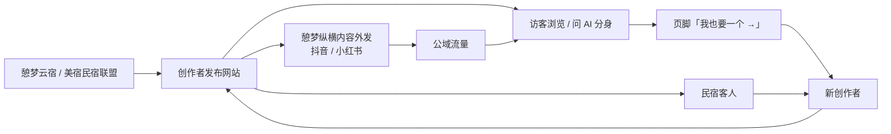

「发现」页和人找人的价值取决于网站数量。在头几百个用户之前，它更像演示；先把「工具」做到有人愿意分享，再谈「平台」。

**MVP 阶段只看五个数：** 采访完成率（开始 → 生成）、发布率（生成 → 发布）、每个网站的访客数（代码已记录）、AI 分身提问数、页脚带来的新用户数。

**商业计划补充说明（待补充项）：** 订阅价格、分佣比例、机构合作报价、成本结构（模型费用按 11.9 测算方式）、收入预测、融资计划等均**待种子用户访谈与团队决策后补充**，本文不预设数字。

---

## 14. 数据埋点与指标

### 14.1 五个核心指标（原文「MVP 阶段只看五个数」）

| 指标 | 公式 | 数据来源（埋点事件） | 当前状态 |
| --- | --- | --- | --- |
| 采访完成率 | 生成网站的会话数 ÷ 开始采访 / 导入的会话数 | `session_start` → `profile_generated` | 待埋点 |
| 发布率 | 发布的网站数 ÷ 生成的网站数 | `profile_generated` → `site_published` | 待埋点 |
| 每个网站的访客数 | 每个网站的访问量 | `site_visit` | 代码已记录 |
| AI 分身提问数 | 访客提问总数 / 每站提问数 | `avatar_ask` | 待埋点 |
| 页脚带来的新用户数 | 来源为页脚「我也要一个 →」且开始会话的用户数 | `footer_cta_click` → `session_start(source=footer)` | 待埋点 |

> 关口判断（第 17 章）以这五个数与「真实用户是否愿意分享网站」为准；各项目标值待补充。

### 14.2 埋点事件表（设计稿）

| 事件名 | 触发时机 | 关键属性 |
| --- | --- | --- |
| `landing_view` | 访问落地页 | source（footer / direct / 生态渠道 / 机构）、ref_slug |
| `demo_start` | 点击「一键体验示例」 | — |
| `session_start` | 开始采访或导入 | mode（interview / import / demo）、source |
| `import_prompt_copy` | 复制导入提问词 | — |
| `import_submit` | 提交粘贴资料 | length、来源类型（AI 总结 / 简历 / 小红书简介，用户自选） |
| `interview_turn` | 每轮采访 | turn_index、topic、is_followup、coverage |
| `llm_fallback` | 大模型出错自动降级 | agent、error_type |
| `profile_generated` | 档案与网站生成 | duration、turns、theme |
| `edit_submit` | 一句话修改 | instruction_type（风格 / 增加服务 / 改文案 / 其他） |
| `site_published` | 发布 | slug、theme |
| `share_copy` / `qr_download` | 复制链接 / 下载二维码 | — |
| `site_visit` | 访客访问个人网站 | slug、referrer、device |
| `machine_file_fetch` | 访问 profile.json / llms.txt / sitemap.xml | file、user_agent 类别 |
| `avatar_open` / `avatar_ask` | 打开 / 提问 AI 分身 | slug、answered_from（faq / profile / handoff） |
| `avatar_handoff` | AI 分身引导联系本人 | slug |
| `contact_click` | 点击联系方式 | channel（微信 / 电话 / 邮箱 / 小红书 / 抖音 / 网站） |
| `footer_cta_click` | 点击「我也要一个 →」 | ref_slug |
| `discover_search` | 发现页搜索 | q、result_count |
| `report_submit` | 举报 | reason |

埋点要求：不采集导入原文与访客对话中的个人敏感信息到分析系统；遵守隐私政策与单独同意；`machine_file_fetch` 仅用于粗粒度判断「是否被 AI / 爬虫读取」，不等于「已被 AI 引用」。

### 14.3 漏斗

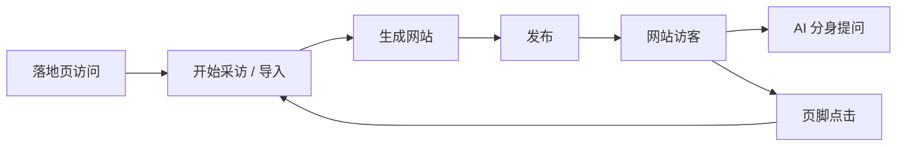

---

## 15. 合规与风险

比赛演示可以先跑起来，但**正式对公众开放前有三道硬门槛：ICP 备案、生成式 AI 应用登记、个人信息保护**。另外，愿景里的「灵魂伴侣」「数字永生」落在一块新的监管区，比赛里建议轻讲。

| 风险 | 具体情况 | 对策 |
| --- | --- | --- |
| 生成式 AI 登记 | 通过 API 调用已备案模型的应用，由地方网信办登记；已上线的应用要在显著位置公示模型名称和备案号（[光明网](https://m.gmw.cn/2026-07/10/content_1304528476.htm)） | 用已备案的国产模型；公司主体尽早向广东省网信办申请登记；代码已留好公示位（`MODEL_NOTICE`） |
| ICP 备案 | 大陆服务器和域名对外提供服务需要备案；用户绑定的独立域名也涉及备案 | 比赛用本地或已备案域名演示；正式版先用子路径 `/u/名字`，独立域名放后 |
| 拟人化互动服务 | 2026 年 7 月 15 日起施行的暂行办法，管的是模拟人格的持续性情感互动（陪伴、情感支持）；智能客服、知识问答、工作助手不适用；并要求明确提示用户在与 AI 互动（[中国政府网](https://www.gov.cn/gongbao/2026/issue_12806/202606/content_7072472.html)） | MVP 的 AI 分身定位为「知识问答 / 客服」，只答档案里的事，已显著标注「AI 生成」；「灵魂伴侣」「离世后的数字分身」立项前单独做合规评估 |
| 个人信息 | 档案里有姓名、联系方式、经历；导入的外部 AI 资料可能含用户不想公开的内容 | 导入原文不公开（已实现）；补隐私政策、单独同意、导出与删除入口 |
| 内容安全 | 任何人都能生成一个「看起来很专业」的页面，可能被用于虚假宣传 | 发布前接云厂商内容安全接口；举报入口；后续做实名认证徽章 |
| 竞品 | Gamma 已支持粘贴简历生成个人网站（[Gamma](https://gamma.app/zh-cn/products/websites/personal-websites)），B12、Manus 等也在做；大厂随时可能跟进 | 不拼「建站」，拼本地生态（民宿联盟、惠州 OPC）、档案数据和人找人网络 |
| 愿景过大 | 七个产品同时讲，评委和用户抓不住重点 | 比赛只讲「时光」一个闭环，生态用一页图带过 |

**合规落地清单（对应正式版需求）**

| 门槛 | 产品 / 技术落地 | 对应功能 |
| --- | --- | --- |
| ICP 备案 | 确定公司主体与域名；国内云部署 | 11.10 部署架构 |
| 生成式 AI 应用登记 | 使用已备案国产模型；页面公示模型名称和备案号 | F14 `MODEL_NOTICE` |
| 个人信息保护 | 隐私政策、单独同意、导出与删除；导入原文不公开 | F12 |
| AI 互动提示 | AI 分身显著标注「AI 生成」 | F7 |
| 内容安全 | 发布前审核、举报、实名认证徽章 | F13、F22 |

---

## 16. 惠州 AI 比赛：7 天冲刺计划

离 11 月 14 日还有 7 天。代码已经能演示，剩下的时间最值得花在两件事上：**拿到 3 位真实用户的网站**（比任何 PPT 都有说服力），和**演示不出错**。

- [ ] 11/8：解压代码，`npm run demo` 跑通；申请 DeepSeek API Key 配好 `.env`；推到 GitHub 私有仓库，邀请铭心追梦
- [ ] 11/9：用真实大模型完整采访 5 遍，调 `src/agent/prompts.js` 的语气；约 3 位真实用户试用（1 位民宿主理人、1 位 OPC、1 位同学）
- [ ] 11/10：部署到云服务器；发布这 3 位用户的网站，让「发现」页有真人
- [ ] 11/11：做路演幻灯片（8–10 页）；录一段 2 分钟演示视频作备份
- [ ] 11/12：计时彩排 3 遍；准备评委问题的回答
- [ ] 11/13：断网演练（`DEMO_MODE=1` 和自动降级）；打印网站二维码；确认比赛时长和评分规则
- [ ] 11/14：比赛

> 各项完成情况以团队实际进度为准（本文不改动原计划勾选状态），执行负责人待补充。

### 16.1 3 分钟演示脚本

1. **0:00–0:30 痛点：** 一个人在五个 AI、三个平台里都有自己的碎片，却没有一个属于自己的门面。AI 时代是人找人，你得先被 AI 读懂。
2. **0:30–1:30 现场生成：** 点「一键体验示例」→ 展示从 DeepSeek 导入的「关于我」→ 生成网站 → 说一句「风格换成简约」→ 发布。有真实用户时，改用他的故事。
3. **1:30–2:10 AI 分身：** 请评委扫码打开网站，问「住宿多少钱」，再问「能带狗吗」——它会诚实地说不知道并引导联系本人。顺手打开 `profile.json`：这个网站也是给 AI 看的。
4. **2:10–2:40 生态：** 一页图讲憩梦矩阵：时光是「人」的入口，云宿/美宿带来首批用户，智荐做人找人，臻选做交易，纵横做内容外发。
5. **2:40–3:00 商业与计划：** 免费 + 订阅 + 交易分佣 + 机构合作；第一步服务惠州的文旅主理人和 OPC。

### 16.2 评委大概率会问

- **和 Gamma / 大厂建站工具有什么不同？** 它们从「文档」生成网页；我们从「人」生成档案，网页只是输出之一，并且有 AI 分身和人找人。
- **怎么赚钱？** 见「商业模式与增长」。
- **合规怎么处理？** 调用已备案国产模型，上线前完成登记和备案，AI 内容显著标注。
- **团队能做完吗？** 现场展示已可运行的产品和测试，讲清楚下一阶段只做什么。

---

## 17. 迭代路线图与里程碑

路线按「先工具、后平台」排：每过一个关口再投入下一阶段。时间是建议，按种子用户的反馈调整。

> 原文此处为嵌入图「迭代路线 · 4 个阶段、3 个关口」。原图的具体阶段名称与关口条件未随文本提供，以下依据原文已有信息（MVP 范围、暂不做清单、商业模式分层、合规门槛、愿景台阶、关口说明）重建，**具体以原图为准，待团队核对**；不设具体日期。

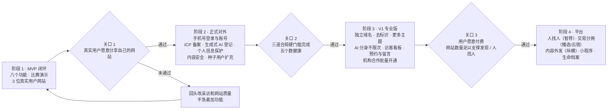

| 阶段 | 主要内容 | 进入下一阶段的关口 | 对应愿景台阶 |
| --- | --- | --- | --- |
| 阶段 1 · MVP 闭环 | 八个功能；比赛；3 位真实用户网站 | 关口 1：真实用户愿意分享自己的网站 | ① 个人网站、② AI 分身雏形 |
| 阶段 2 · 正式对外 | 账号体系；三道合规门槛；内容安全；种子用户扩充（民宿联盟、惠州 OPC） | 关口 2：合规完成、五个数健康（阈值待补充） | ①② 完善 |
| 阶段 3 · V1 专业版 | 专业版订阅；机构合作 | 关口 3：付费意愿得到验证、网站数量足够（阈值待补充） | ② AI 分身强化 |
| 阶段 4 · 平台 | 人找人匹配、交易分佣、内容外发、小程序、生命档案 | — | ③ 连接与交易、④ 内容外发、⑤ 生命档案 |

关口比日期更重要：如果真实用户不愿意分享自己的网站，先回头改采访和网站质量，不要急着加功能。

### 17.1 里程碑

| 里程碑 | 时间 | 交付物 | 完成标准 | 负责人 |
| --- | --- | --- | --- | --- |
| M0 方案定稿 | 2026-11-07 | 《项目梳理与 MVP 架构方案》 | 已完成 | @David |
| M1 代码就绪 | 11/8 | `npm run demo` 跑通、`.env`、GitHub 私有仓库 | 仓库已建、协作者已邀请 | 杜明航 |
| M2 提示词调优 + 真实用户 | 11/9–11/10 | 5 遍真实采访；3 位用户网站上线；云服务器部署 | 发现页有真人 | 杜明航 / 待补充 |
| M3 路演材料 | 11/11 | 8–10 页幻灯片、2 分钟备份视频 | — | 待补充 |
| M4 彩排与断网演练 | 11/12–11/13 | 3 遍计时彩排、`DEMO_MODE=1` 演练、二维码 | 全部无中断 | 待补充 |
| M5 比赛 | 11/14 | 现场演示 | 演示成功 | 全员 |
| M6 PRD 完整版 | 2026-11-12 | 本文档 | 评审通过 | 杜明航 |
| M7 关口 1 评估 | 待补充 | 种子用户数据（五个数） | 用户愿意分享网站 | 待补充 |
| M8 正式对外上线 | 待补充 | 账号、合规三门槛、内容安全 | 备案与登记完成 | 待补充 |
| M9 V1 专业版 | 待补充 | 专业版功能、定价 | 首批付费用户 | 待补充 |

---

## 18. 需要团队拍板的问题

**原文问题（保留）**

- [ ] 比赛的具体形式：路演多长、能不能现场演示、评分看什么、对公司注册和团队有没有要求？（公开资料里没找到这场比赛的细则）
- [ ] 首批种子用户先找民宿主理人还是 OPC？谁负责去约这 3 位试用者？
- [ ] 用哪家大模型（DeepSeek / 通义千问 / 豆包），API 费用谁来出？
- [ ] 用哪个公司主体做 ICP 备案和生成式 AI 应用登记？域名定了吗？
- [ ] 比赛里要不要讲「灵魂伴侣」「离世后的数字分身」？建议只在愿景里一句带过。
- [ ] 会议纪要里两处疑似转写错误：「七梦」应是「憩梦」（不过生态恰好 7 个产品，「七梦」可以顺势用作品牌说法）；「将憩梦时光调整为憩梦时光」里的原名是什么？
- [ ] GitHub 仓库归属：个人账号还是新建组织？

**本版新增**

- [ ] **产品命名不一致：** 原 PRD 为「憩梦时光」，《憩梦品牌视觉规范 V2.0》中个人数字人生操作系统为「憩梦拾光」（陶土 #A9532F）。本文暂保持「憩梦时光」并采用拾光陶土主题，最终名称待定（可能与上一条「原名是什么」相关）。
- [ ] **生态产品名称对应：** 原 PRD 提到智荐（GEO）、纵横（内容外发），视觉规范中为智鉴（GEO-Agent 智能运营工作台）、星光（全自媒体矩阵内容分发获客系统），是否为同一产品的不同叫法？7 个产品的完整名单？
- [ ] **正式版前端框架：** Vue 3 还是 React？后端 NestJS 还是 Fastify？
- [ ] **GitHub 仓库名与可见性：** 在 <https://github.com/123Daved> 下的仓库名、私有 / 公开、协作者权限。
- [ ] **团队成员与分工：** 除杜明航外的成员姓名、角色。
- [ ] **@David 与杜明航的署名关系**（原方案作者署名 @David）。

---

## 19. 资料来源

- [广东发布人工智能 OPC 三年行动方案（2026–2028）](https://info.newsgd.com/node_8b2d4f3946/2ea0969f74.shtml)
- [惠州发布 2026 年首批 AI 应用场景需求清单](https://www.newsgd.com/node_99363c4f3b/f0213e1492.shtml)
- [惠阳首个 OPC 未来社区揭牌](https://www.sohu.com/a/1069598240_100116740)
- [国家网信办：生成式人工智能服务备案与应用登记公告](https://m.gmw.cn/2026-07/10/content_1304528476.htm)
- [《人工智能拟人化互动服务管理暂行办法》](https://www.gov.cn/gongbao/2026/issue_12806/202606/content_7072472.html)
- [Gamma 个人网站生成](https://gamma.app/zh-cn/products/websites/personal-websites)
- [DeepSeek API 文档](https://api-docs.deepseek.com/)
- 《憩梦品牌视觉规范 V2.0》（2026-10-21 生效，版本 2.0.0，内部文档）

---

## 附录 A　代码仓库

### A.1 仓库信息

| 项 | 内容 |
| --- | --- |
| GitHub 账号 | <https://github.com/123Daved>（杜明航） |
| 仓库名 | 待补充（建议：`qimeng-shiguang-mvp`，与代码包 `qimeng-shiguang-mvp.zip` 同名） |
| 可见性 | 私有（原计划：推到 GitHub 私有仓库） |
| 协作者 | 铭心追梦（原计划 11/8 邀请）；其他待补充 |
| 归属 | 个人账号还是新建组织，待拍板（第 18 章） |
| 代码规模 | 约 2900 行，零依赖 |
| 运行 | Node.js 18.17+；`npm run demo` |
| 测试 | 14 个自动化测试 |
| 上传状态 | 待执行：将 `qimeng-shiguang-mvp.zip` 解压后推送至上述仓库（需仓库所有者登录 GitHub 完成或授权） |

### A.2 建议目录结构

> MVP 部分：原文明确提到的为 `src/agent/prompts.js`、`store.js`、`render.js`、`data/`、`.env`，其余文件名为**建议 / 示意**，以实际代码为准。

```text
qimeng-shiguang-mvp/
├── README.md
├── package.json              # scripts: demo / start / test（零依赖）
├── .env.example              # 模型地址、API Key、模型名、DEMO_MODE、MODEL_NOTICE
├── .gitignore                # 忽略 .env、data/ 下的用户数据
├── docs/
│   ├── PRD/                  # 本文档
│   └── brand/v2.0/           # 品牌视觉规范受控副本（HTML / MD / tokens JSON / CSS）
├── public/                   # 原生 HTML / JS 工作台、落地页、发现页（建议）
├── src/
│   ├── server.js             # HTTP 入口与路由，含 /u/名字（建议命名）
│   ├── service/              # 业务编排：采访、导入、生成、修改、发布（原文：service）
│   ├── agent/
│   │   ├── prompts.js        # 四个智能体提示词（原文）
│   │   ├── llm.js            # OpenAI 兼容接口调用（建议命名）
│   │   └── offline.js        # 离线规则版智能体（建议命名）
│   ├── store.js              # 存储抽象，换 SQLite / PostgreSQL 只改这里（原文）
│   ├── render.js             # 模板渲染：网页 + JSON-LD + profile.json + llms.txt + sitemap.xml（原文）
│   └── themes/               # 3 套主题模板（建议）
├── data/                     # JSON 文件存储（原文），不入库
└── test/                     # 14 个自动化测试
```

正式版（规划）建议拆为 monorepo：`apps/web`（工作台，Vue 3 / React + TS + Vite）、`apps/site`（个人网站 SSR / 静态化）、`apps/miniprogram`、`services/api`（NestJS / Fastify）、`packages/tokens`（qidream-tokens.v2.0 生成的 CSS / WXSS）、`packages/ui`（组件库）、`packages/profile-schema`（档案 schema）。

### A.3 分支规范（建议）

| 分支 | 用途 | 规则 |
| --- | --- | --- |
| `main` | 可演示 / 可发布版本 | 受保护；仅通过 PR 合并；测试全部通过 |
| `dev` | 日常集成 | 功能分支合入目标 |
| `feature/<简述>` | 新功能，如 `feature/import-memory` | 从 `dev` 切出 |
| `fix/<简述>` | 缺陷修复 | 从 `dev` 切出；紧急修复可从 `main` 切 `hotfix/<简述>` |
| `release/<版本>` | 比赛 / 上线前冻结，如 `release/demo-1114` | 只修缺陷 |

- 提交信息建议采用 Conventional Commits：`feat:`、`fix:`、`docs:`、`refactor:`、`test:`、`chore:`。
- 标签：比赛版本打 `v0.1.0-demo`（建议）。
- 严禁提交 `.env`、API Key 与 `data/` 下的真实用户数据。

### A.4 README 要点

1. 项目一句话：聊 10 分钟，AI 帮你生成一个「既能被人找到、也能被 AI 找到」的个人网站。
2. 功能列表：MVP 八个功能。
3. 快速开始：Node.js 18.17+；复制 `.env.example` 为 `.env`；`npm run demo`。
4. 配置说明：OpenAI 兼容接口地址、API Key、模型名（默认 `deepseek-v4-flash`，关闭思考模式）、`DEMO_MODE=1`、`MODEL_NOTICE`。
5. 架构图与数据流（11.1）。
6. 目录结构（A.2）。
7. 测试：运行方式与 14 个测试覆盖范围。
8. 演示指南：一键体验示例、断网演练。
9. 安全与隐私：转义、链接清洗、导入原文不公开；不要提交 `.env`。
10. 合规提示：上线前 ICP 备案、生成式 AI 应用登记、个人信息保护。
11. 品牌规范：引用 `docs/brand/v2.0/`。
12. 贡献与分支规范（A.3）；成员与联系方式。

---

## 附录 B　待补充事项汇总

| 编号 | 待补充项 | 所在章节 |
| --- | --- | --- |
| B1 | 除杜明航外的团队成员姓名、角色、职责；铭心追梦的具体角色 | 1 |
| B2 | 憩梦生态 7 个产品完整名单及与视觉规范产品名的对应 | 0.1、18 |
| B3 | 五个核心指标及体验指标的目标值 | 5.3、7.5、14 |
| B4 | 用户画像量化特征（访谈后） | 6.1 |
| B5 | 机构用户的当前做法与痛点 | 6.1 |
| B6 | AI 分身免费版每月限次的具体次数 | 9.3 F7 |
| B7 | 3 套主题的名称 | 9、12.10 |
| B8 | 性能目标（采访响应 P95、首屏加载） | 10、11.9 |
| B9 | 单站成本金额（待选定模型后按单价测算） | 11.9 |
| B10 | 订阅价格、分佣比例、机构报价、收入预测、融资计划 | 13 |
| B11 | 图标库名称；正式 Logo 矢量资产、最小尺寸与安全区；拾光已确认字号调整数值 | 12.4、12.6 |
| B12 | 迭代路线原图的阶段名称与关口条件核对；各关口阈值 | 17 |
| B13 | 里程碑 M3–M9 负责人与时间 | 17.1 |
| B14 | GitHub 仓库名、可见性、归属，以及代码上传 | 附录 A |
| B15 | MVP 实际文件结构与接口路由（以代码为准） | 11、附录 A |
