# 憩梦时光 · 项目介绍书

聊 10 分钟，AI 帮你生成一个「既能被人找到、也能被 AI 找到」的个人网站。

本文介绍当前仓库里的 MVP：它做什么、按产品需求文档的哪一条实现、怎么在本地跑、怎么部署，以及用双月湾民宿主理人「阿岚」走通的一次真实演示。

## 1. 项目是什么

憩梦时光是一个以人为中心的个人门面。用户不用会写文案，也不用懂建站。通过一段采访，或把别的 AI 里已经形成的「关于我」贴回来，系统整理出一份结构化人生档案，再用模板渲染成个人网站。

网站同时给人读，也给 AI 读。页面里有 JSON-LD，旁边还有 `profile.json` 和 `llms.txt`，全站有 `sitemap.xml`。访客可以直接问网站上的 AI 分身；分身只根据档案回答，答不了就请对方联系本人。

数字人生、交易和内容分发是后面的台阶。比赛和第一批用户要看到的，是这一条闭环。

## 2. 两个核心想法

**一键生成网页。** 不会写也能做。路径是：采访或导入 → 生成档案 → 模板出网站 → 一句话修改 → 发布 `/u/名字`。大模型只整理事实和文案，网页由模板渲染，所以不会生成坏页面，用户内容也会统一转义。

**AI 时代人找人。** 找人的不只有游客和客户，还有替人办事的智能体。一个人若希望在「惠州双月湾有没有靠谱的民宿主理人」这种问题里被找到，就需要一份机器读得懂的档案。`services`（我能提供）和 `seeking`（我在寻找）从第一版就采集，发现页先用关键词把人找出来。

## 3. 团队

| 姓名 | 角色 | 在这个 MVP 里做的事 |
| --- | --- | --- |
| 杜明航 | 产品经理 + 全栈开发 | 产品范围、PRD、工作台与个人网站、四个智能体、档案存储、部署 |

其他成员的分工在 PRD 里仍待补充，这里不推定。

## 4. 功能与 PRD 的对应

MVP 范围以《憩梦时光 PRD 完整版》第 9 章为准。

| PRD | 功能 | 在产品里的位置 |
| --- | --- | --- |
| F1 | AI 采访 | 工作台一次只问一个问题，覆盖 6 个话题；笼统回答最多追问一次；顶部进度同时标出未覆盖、进行中、已覆盖 |
| F2 | 导入其他 AI 的记忆 | 可复制提问词，粘贴 DeepSeek、豆包、Kimi 等的总结，简历和小红书简介也可以。导入原文不公开 |
| F3 | 档案抽取 + 3 套模板 | 整理师产出档案 v0.1；主题为温暖、简约、墨色，工作台里用缩略图切换，三套版式彼此可区分 |
| F4 | 一句话修改 | 例如「风格换成简约」。生成后提供建议短句，也可以自己写。服务端保证只改被要求的字段 |
| F5 | 发布 `/u/名字` | 同名不覆盖别人；发布后的修改写回同一网址。会话链接就是编辑密钥 |
| F6 | 机器可读 | 页面 JSON-LD，`/u/名字/profile.json`，`/u/名字/llms.txt`，`/sitemap.xml` |
| F7 | AI 分身 | 只依据档案回答，对话框和每条回复都标「AI 生成」；换身份指令无效；不知道就引导联系本人 |
| F8 | 发现页 + 演示 / 降级 | 关键词搜索已发布的人；`npm run demo` 或没有密钥、接口出错时走离线规则 |
| F9 | 页脚「我也要一个 →」 | 每个公开网站页脚都有，点击回到首页并记下来源 |
| F10 / F14 | 访客数、模型公示 | 访问次数和提问次数可查；页脚有 `MODEL_NOTICE` 公示位 |

档案字段按第 11.4 节：`name`、`title`、`tagline`、`city`、`tags`、`about`、`services[]`、`seeking[]`、`highlights[]`、`story`、`contacts`、`faq[]`、`theme`、`accent`。

## 5. 架构

零依赖的 Node.js 单体。创作者的每一句话进 service，再交给四个智能体之一。模型走 OpenAI 兼容接口；失败、没有密钥或 `DEMO_MODE=1` 时改用离线规则。档案写成 `data/` 里的 JSON，再由 `render.js` 输出网页和给 AI 读的文件。

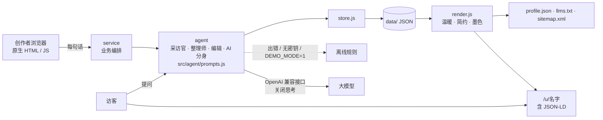

换模型只改 `.env`。调语气只改 `src/agent/prompts.js`。以后换数据库只改 `src/store.js`。

## 6. 技术栈

- 运行时：Node.js 18.17+，不安装第三方包
- 前端：原生 HTML / CSS / JS，没有构建步骤
- 模型：OpenAI 兼容接口。示例配置为 `LLM_BASE_URL=https://token.iflink.tech/v1`，`LLM_MODEL=deepseek-v4.1-flash-1017`
- 存储：JSON 文件
- 视觉：憩梦拾光陶土色 `#A9532F` 作为主行动和产品识别（主按钮配白字，不用母品牌青玉绿做主按钮）。页脚保留克制的「憩梦」母品牌署名。工作台与网站使用 PRD 第 12 章的语义色、中文系统字体、4px 间距、8px / 12px 圆角、统一的 24px 线性图标，以及「憩梦时光」文字标志
- 测试：Node 自带的 `node:test`

这个模型会把额度花在思考上。思考没关掉、而且 `max_tokens` 又很小时，`content` 会是空的，正文留在 `reasoning` 里。两种关闭方式都有效，本项目两个都发送：

- `thinking: { "type": "disabled" }`
- `chat_template_kwargs: { "enable_thinking": false }`

核对结果：只发其中任意一个，或两个一起发，`reasoning_tokens` 都是 0，`content` 里有正文。两个都不发、并且 `max_tokens` 只有 20 时，`content` 为空。若 `content` 仍为空，会再从 `reasoning` / `reasoning_content` 里取答案；还是不行就降到离线规则。采访用 800 token，整理和修改用 3500 token。接口失败会自动再试一次，第二次仍失败才降级。

首页首屏是一张海边露台的全屏图，上面是宋体大标题「憩梦时光」、原有的一句话介绍和两个按钮；往下依次是三步说明、「AI 时代人找人」（左边是给人看的网页，右边逐行打出 profile.json 和 llms.txt）、配图的采访说明、三张差异卡片和收尾的行动区。字体只用系统自带的中文宋体和黑体，不下载网络字体。动效包括滚动淡入、首图缓慢推近、按钮和卡片的轻微浮起、发布成功的勾选动画、切换主题时预览淡入；都控制在 600 毫秒以内，系统开启「减少动态效果」时全部关闭，脚本没加载时内容也照常显示。工作台把采访对话、导入、档案、主题缩略图、一句话修改和发布放在左侧，桌面端右侧固定显示网页预览；顶部进度条显示已覆盖几个话题，生成时预览区显示骨架屏。提交中的按钮会显示「生成中」「发布中」等状态，避免连点。温暖、简约、墨色三套个人网站模板共用同一套信息结构，版式和疏密不同。发现页按关键词列出已发布的人，空结果不会编造。

## 7. 本地运行

需要 Node.js 18.17 或更高。

```bash
cp .env.example .env
# 编辑 .env，填入 LLM_API_KEY。不要把 .env 提交到仓库。
npm start
```

浏览器打开 <http://127.0.0.1:3000>。

没有密钥、或要做断网演练：

```bash
npm run demo
```

这会强制 `DEMO_MODE=1`，全程走离线规则，采访、生成、修改、发布和 AI 分身仍能走完。

测试：

```bash
npm test
```

## 8. 部署

仓库带有 `Dockerfile` 和 `render.yaml`。容器只复制代码，不复制 `.env` 和 `data/`。

Render 上建成一个 Node Web Service，启动命令是 `npm start`。在服务的环境变量里填写下面这些名字，不要把值写进仓库：

- `LLM_BASE_URL`
- `LLM_MODEL`
- `LLM_API_KEY`
- `DEMO_MODE`（正式环境用 `0`；现场断网演练用 `1`）
- `MODEL_NOTICE`（上线前换成真实的模型名称和备案号）
- `PUBLIC_BASE_URL`（对外的 https 地址，用于二维码和 sitemap）

用 Docker 时：

```bash
docker build -t qimeng-shiguang .
docker run --env-file .env -p 3000:3000 qimeng-shiguang
```

对外公开之前，还需要 ICP 备案、生成式 AI 应用登记，以及隐私政策、导出和删除。这些不在本 MVP 里。

## 在线体验与部署现状

线上地址：<https://qimeng-shiguang.onrender.com>

- 平台：Render 免费套餐
- 区域：Singapore
- 发布：`main` 分支推送后自动部署
- 模型相关环境变量已经配在 Render 上，不写进仓库

Render 免费实例闲置后会休眠，首次打开可能需要等待约 1 分钟。免费版没有持久磁盘，重启后 `data/` 里的网站会清空（正式版换 PostgreSQL 或挂载磁盘）。为了发现页不会一片空白，启动时如果还没有示例网站阿岚，会自动放回这一份演示档案，即使已经有其他已发布的网站。网址是 `/u/阿岚`，也可以用英文别名 `/u/alan`。如果有人已经发布了名为 alan 的网站，英文地址会优先显示那一份，不会把示例站点写成第二个网站。页面和发现卡片都标着「示例」。这是截图里的那一份演示档案，不是真实用户。

## 9. 一次真实使用：阿岚

下面用 PRD 里的双月湾民宿主理人阿岚走了一遍。材料是一份「从其他 AI 贴回来的关于我」，里面有房型、价格、故事和联系方式，故意没写网站风格，好让采访官再追问一句。模型是 `deepseek-v4.1-flash-1017`，思考已关闭。

1. 打开首页，点「开始制作」。

   

   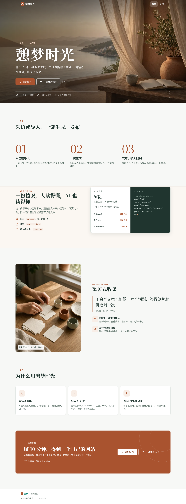

2. 把阿岚的资料贴进「导入 AI 记忆」。原文只留在这个会话里。

   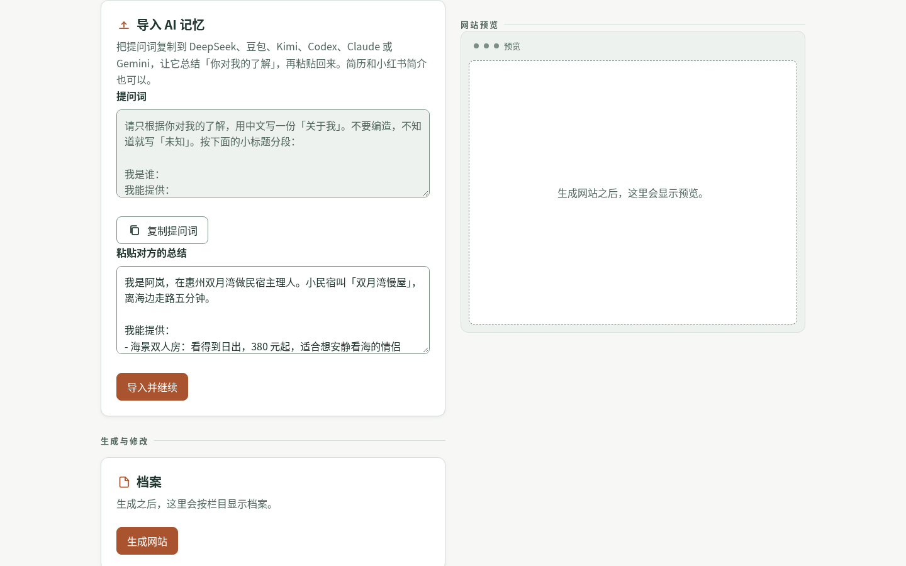

3. 进度条标出已经覆盖的五个话题。采访官只再问一句：你希望「双月湾慢屋」给人什么样的感觉？

   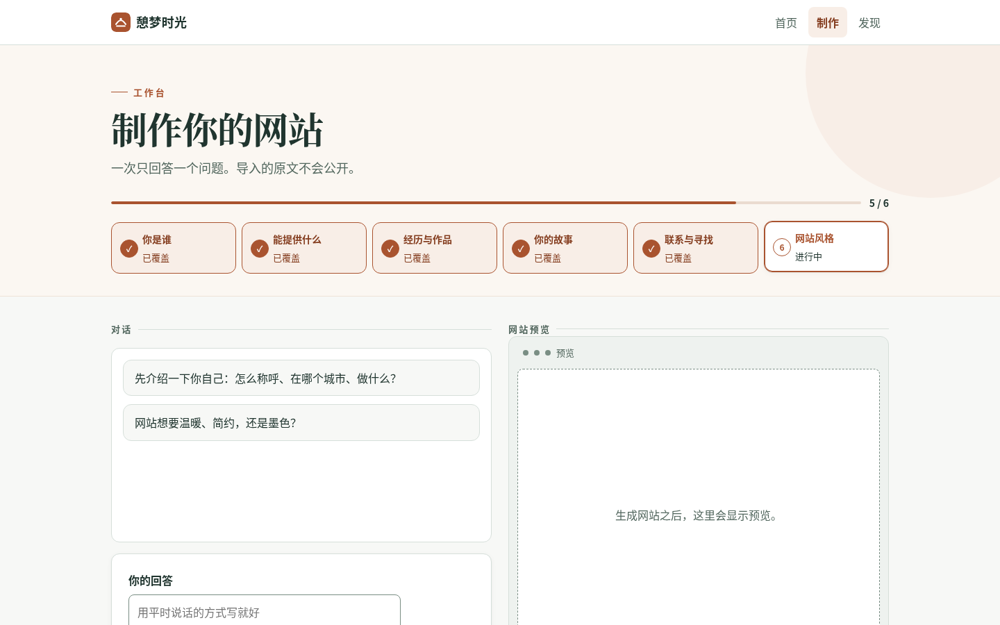

4. 回答「温暖，像住在朋友家里，颜色用陶土。」然后点「生成网站」。整理师只使用材料里的事实：三个服务和价格、双月湾、联系方式都在，没有编出档案里没有的事。

   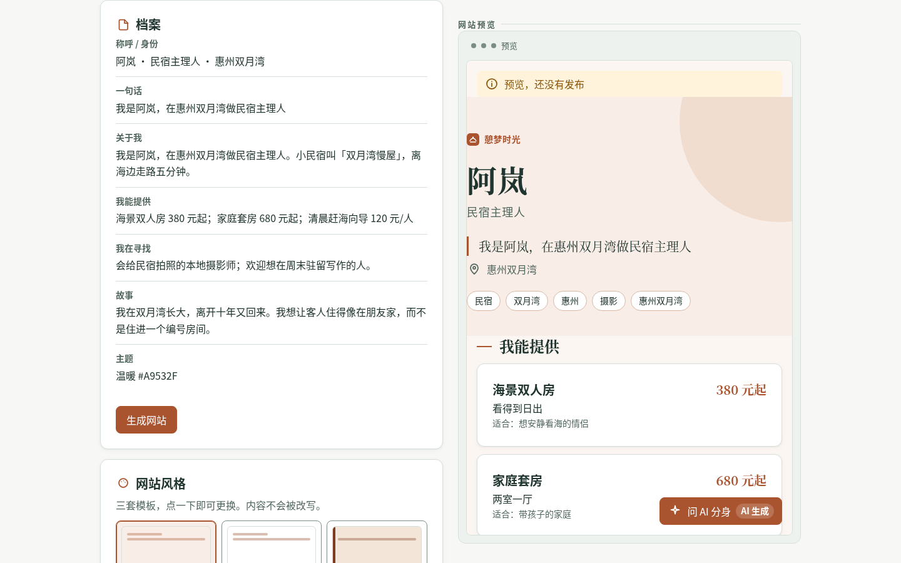

5. 说一句「风格换成简约」。版式从陶土色卡片换成留白和细线，服务和故事没有被改写。

   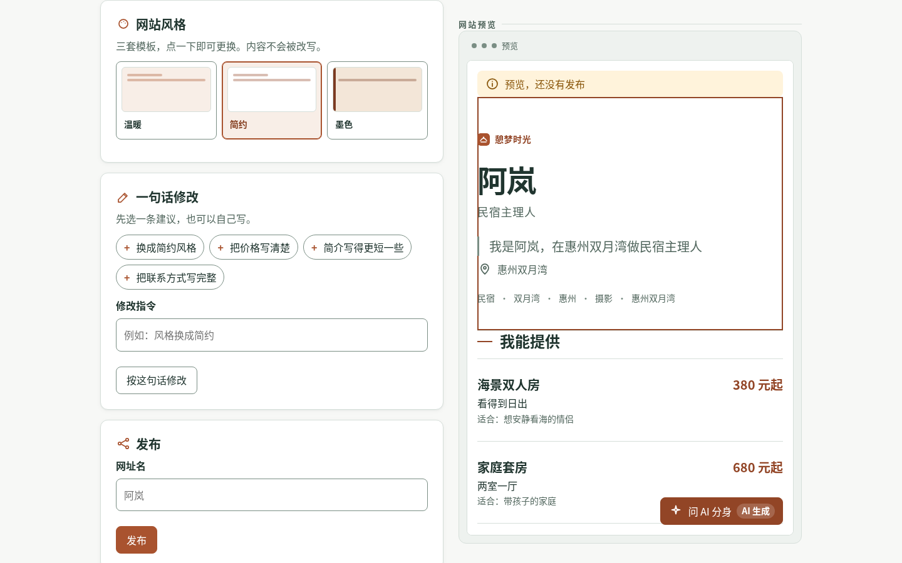

6. 发布。网址是 `/u/阿岚`，同时给出二维码、`profile.json` 和 `llms.txt`。

   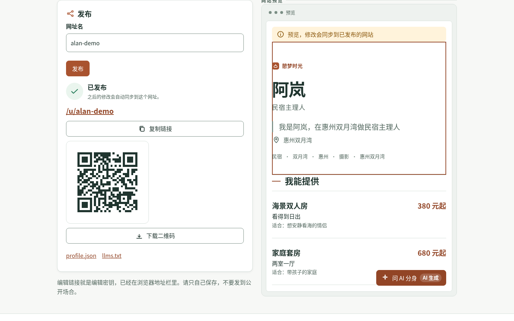

7. 公开页先讲她是谁，第二屏是服务清单，后面是故事、寻找和联系方式。页脚有「我也要一个 →」。

   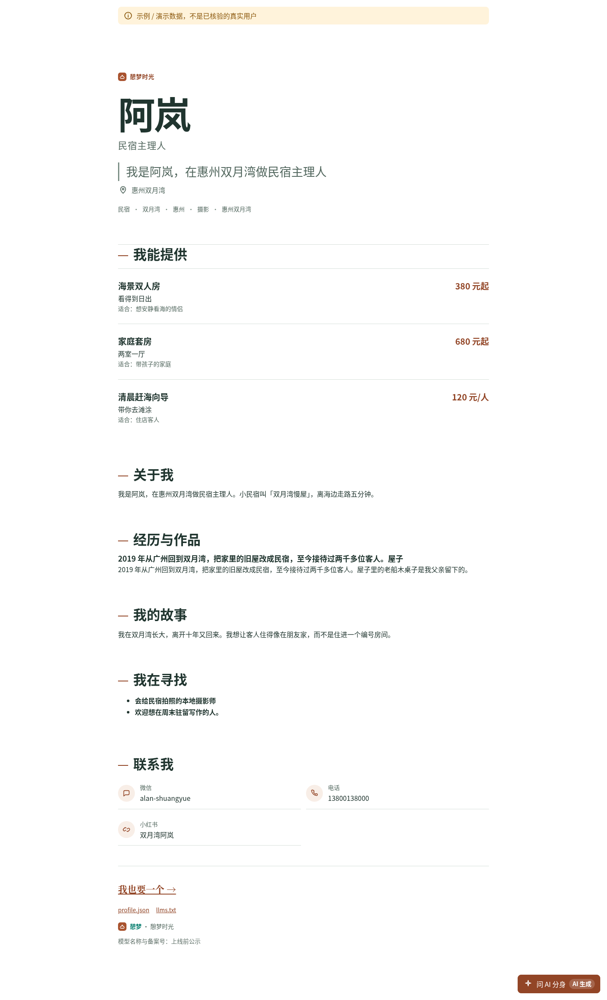

8. 问 AI 分身「住宿多少钱？」回答与档案一致：海景双人房 380 元起，家庭套房 680 元起，含简单早餐。再问「周末能带狗吗？」档案没写这件事，分身明确说没有答案，并给出微信和电话。每条回复都标着「AI 生成」。

   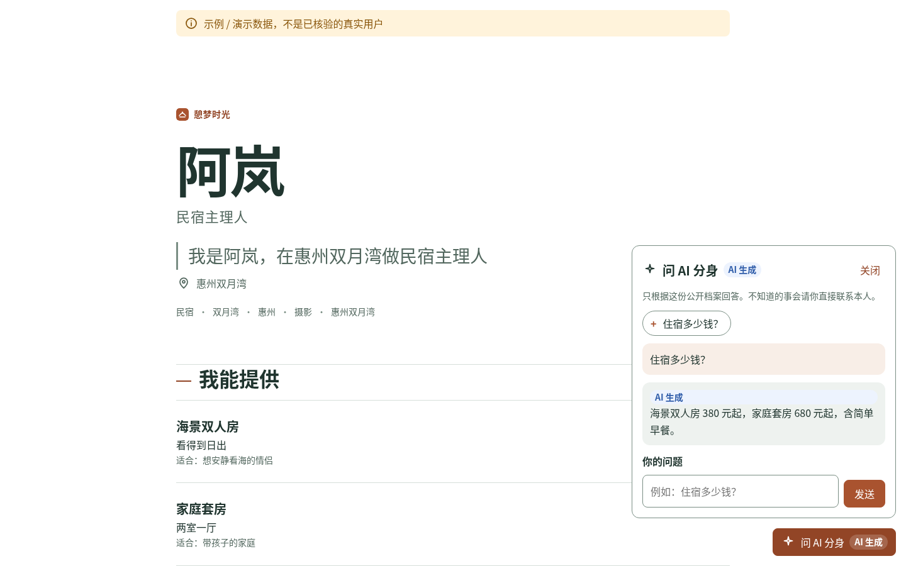

9. 发现页搜「双月湾」，出现阿岚，没有编造其他人。

   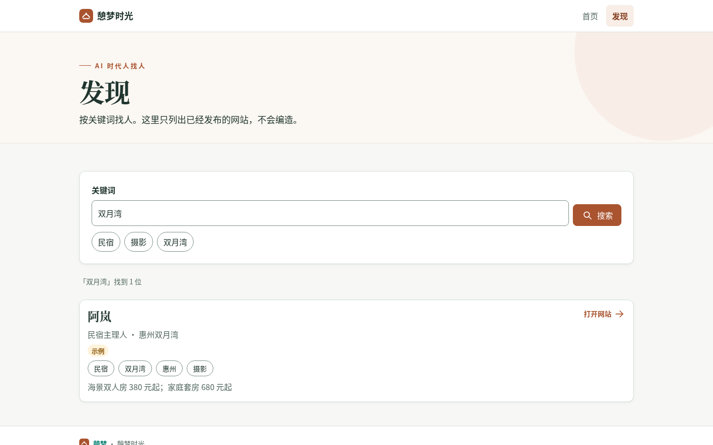

手机宽度下的同一流程：

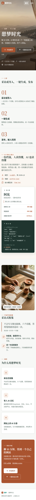
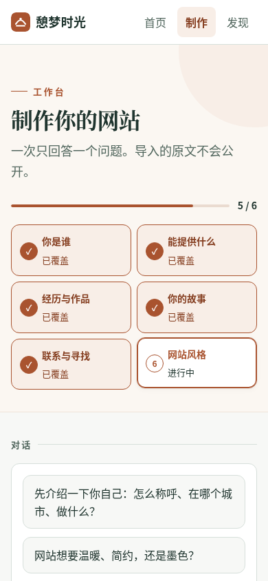
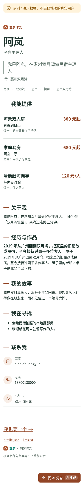


这一轮模型输出的质量：

- 采访官的追问只有一个问题，而且用了资料里的民宿名。
- 档案保留了三档价格、赶海向导、老船木桌子和「住得像在朋友家」。`about` 停在自我介绍，没有把故事再贴一遍。
- 「风格换成简约」只改变了主题和强调色。
- 价格问答和档案里的 FAQ 一致。带狗这个问题不在档案里，分身没有编造规则。
- 整理接口曾经有一次瞬时失败，产品自动再请求一次后成功；若再失败会改用离线规则，页面不会停住。离线规则能走完流程，但文案比模型粗糙，只适合演示和兜底。

## 10. 测试

`npm test` 使用 Node 自带测试运行器，**16 项全部通过，0 项失败**。覆盖 PRD 第 11.11 节的验证清单，并检查示例网站的种入与英文别名：

| # | 测试 |
| --- | --- |
| 1 | 离线模式走完采访、生成、修改、发布、分身和发现 |
| 2 | 本地模拟接口核对请求格式、思考开关，并走完生成发布 |
| 3 | 大模型返回 500 时自动降级，流程不中断 |
| 4 | `<script>` 被转义，温暖 / 简约 / 墨色都能渲染服务清单 |
| 5 | `javascript:` 链接被去掉，https、mailto、tel 保留 |
| 6 | 路径穿越读不到数据目录或仓库文件 |
| 7 | 同名网址不覆盖别人的网站 |
| 8 | 发布后的修改自动出现在公开页 |
| 9 | 导入原文不出现在公开页、profile.json、llms.txt |
| 10 | 没有编辑密钥不能改会话 |
| 11 | 笼统回答只追问一次，每轮只有一个问题 |
| 12 | 发现页空结果不编造；JSON-LD、profile.json、llms.txt、sitemap 可用 |
| 13 | 页脚、访客数、模型公示和一键体验示例 |
| 14 | `content` 为空时改从推理字段解析；二维码可以生成 |
| 15 | 空数据目录启动时种入示例网站 `/u/阿岚` 与 `/u/alan`；阿岚已在时不重复种入，缺失时即使已有其他网站也会补回 |
| 16 | 若有人发布了名为 alan 的网站，`/u/alan` 优先显示该网站；路径穿越仍然被拒绝 |

## 11. 已知限制

- 没有账号。谁拿到会话链接，谁就能编辑。正式对外前要换成手机号登录。
- 不上传图片、语音和视频，也没有独立域名和支付。
- 发现页只做关键词，还没有 `services × seeking` 的匹配。
- AI 分身的免费次数只计数，还没有按月拦截。具体额度 PRD 里待定。
- 离线整理靠规则，适合断网演示，不适合当正式文案。
- `MODEL_NOTICE` 现在是公示位，备案号要上线前填上。
- 隐私政策、单独同意、导出和删除、内容安全审核还没做。
- 品牌规范的受控副本 `docs/brand/v2.0/` 没有随仓库提供。颜色和间距按 PRD 第 12 章写在样式里。
